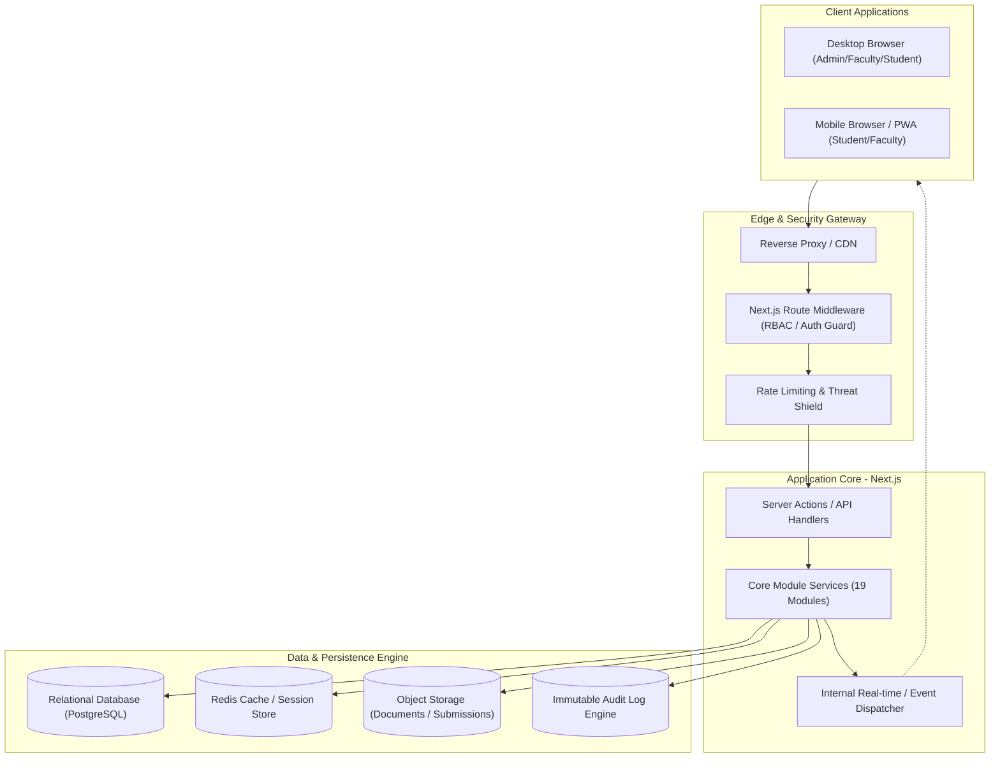

# Axis LinkUp — Project Overview

> **Document ID:** DOC-REQ-001  
> **Status:** Draft for Review (Phase 1, Part 1.1)  
> **Institution:** Axis Institute of Technology & Management  
> **Target Audience:** Engineering Leads, System Architects, Product Owners, Institutional Stakeholders  
> **Last Updated:** November 2026  

---

## 1. Executive Summary

**Axis LinkUp** is an enterprise-grade, unified College Communication & Productivity Platform engineered specifically for **Axis Institute of Technology & Management**. The platform serves as the central digital nervous system of the institution, interconnecting four foundational user roles: **Students**, **Faculty**, **Administrators**, and **Super Administrators**.

Historically, collegiate workflows at Axis Institute have relied on fragmented, disparate, and ad-hoc communication channels (WhatsApp groups, unorganized email threads, physical bulletin boards, paper-based requisition slips, and decentralized Google Drive links). This fragmentation introduces communication latency, information asymmetry, academic missed deadlines, lack of auditability, and operational overhead.

Axis LinkUp consolidates academic delivery, campus administration, real-time peer-to-peer and broadcast communication, student governance, and student career milestones into a single, cohesive, high-performance web platform built on modern web engineering standards.

---

## 2. Vision and Mission

### 2.1 Product Vision
To build a secure, real-time, zero-friction digital campus ecosystem that eliminates operational silos, empowers faculty in teaching and mentoring, simplifies administrative governance, and provides students with an integrated hub for academic excellence and personal growth.

### 2.2 Product Mission
- **Unify Communications:** Replace informal messaging channels with official, audited, role-controlled communication spaces.
- **Streamline Academic Workflows:** Centralize syllabus distribution, assignment life-cycles, academic timetables, and learning resources.
- **Digitize Administrative Services:** Transform physical paper-based desk requests (e.g., bonafide certificates, fee receipts, lab access, leave requests) into trackable digital tickets with Service Level Agreements (SLAs).
- **Foster Professional Growth:** Track and showcase extracurricular activities, technical skills, verified certifications, and achievements via a digital Passport.
- **Ensure Campus Safety & Urgency:** Provide a high-priority, tamper-proof Emergency Broadcast system capable of commanding attention in critical situations.

---

## 3. Problem Statement & Operational Inefficiencies

| Traditional Campus Problem | Operational Impact | Axis LinkUp Solution |
| :--- | :--- | :--- |
| **Fragmented Notice Channels** | Notices posted on WhatsApp or physical boards get lost or go unnoticed; no read receipts or targeting. | **Targeted College Notices Module:** Department-, semester-, and role-filtered official notices with priority tags, acknowledgment tracking, and audit trails. |
| **Academic Information Chaos** | Assignments submitted via email/WhatsApp drive; faculty struggle to track deadlines, versions, and submissions. | **Assignments & Notes Modules:** Centralized assignment lifecycle management, deadline enforcement, structured file submissions, and organized subject repositories. |
| **Manual Requisitions & Approvals** | Students wait in lines at administrative offices for certificates, NOCs, and grievance redressals with zero visibility into status. | **Student Request Tracker:** Ticketing system with automated status workflows, role assignment, ticket history, and SLA tracking. |
| **Ad-Hoc Unmoderated Chat** | Inappropriate group chats, lack of faculty privacy, mixing personal numbers with institutional work. | **Institutional Real-Time Chat & Groups:** Role-bound chat rooms, department/course channels, privacy-preserving messaging without exposing personal phone numbers. |
| **Under-utilized Campus Resources** | Vacant labs and classrooms are difficult to identify in real time for project work or extra classes. | **Room & Lab Finder:** Real-time occupancy tracking, capability tags (equipment, capacity, projector), and booking requests. |
| **Unverified Student Portfolios** | Resumes are self-claimed without institutional verification of hackathons, clubs, workshops, or academic milestones. | **Skill & Achievement Passport:** Verified digital credentials and extracurricular record validated by faculty coordinators. |
| **Delayed Emergency Communication** | Campus closures, severe weather, or security alerts spread via rumors without an authoritative broadcast. | **Emergency Mode:** System-wide UI override, instant multi-channel push, and mandatory acknowledgment banner. |

---

## 4. Core Value Propositions

### 4.1 For Students
- **Single Pane of Glass:** One dashboard for class notices, upcoming assignment deadlines, class timetables, and grades/resources.
- **Clear Administrative Visibility:** Track the exact stage of any requisition (e.g., "Submitted" &rarr; "Under Review by Registrar" &rarr; "Approved / Ready for Pickup").
- **Privacy & Safety:** Collaborate with peers and faculty without sharing personal mobile numbers or personal social media handles.
- **Digital Legacy:** Build an institution-verified Skill & Achievement Passport ready for placement drives and higher education applications.

### 4.2 For Faculty
- **Efficient Classroom Management:** Single repository to publish lecture notes, assign coursework, enforce deadlines, and review submissions.
- **Protected Personal Time:** Controlled interaction channels; faculty can define virtual office hours and restrict communication to institutional channels.
- **Direct Engagement:** Host polls, gauge student comprehension, and post urgent course announcements with guaranteed delivery.
- **Reduced Paperwork:** Review and approve student requests (e.g., lab access, leave, project endorsements) digitally with one click.

### 4.3 For Campus Administrators
- **Structured Workflows:** Queue-based ticket handling for student services with audit logs and accountability metrics.
- **Departmental Governance:** Publish notices scoped strictly to specific branches, years, or entire campus cohorts.
- **Space Management:** Visibility into lab and classroom utilization across campus blocks.
- **Operational Metrics:** Comprehensive reporting on request turnaround times, notice read rates, and resource utilization.

### 4.4 For Super Administrators (Executive & IT Leadership)
- **Centralized Governance:** Granular Role-Based Access Control (RBAC) ensuring adherence to the principle of least privilege.
- **Total Auditability:** Comprehensive, immutable audit logs capturing every administrative action, permission change, and broadcast.
- **Campus Emergency Control:** Rapid trigger mechanism to dispatch emergency alerts across all connected screens and push notification channels.
- **System Health & Analytics:** Real-time visibility into platform activity, storage utilization, and security event logs.

---

## 5. Scope of the Platform

### 5.1 In-Scope (Phase 1 Baseline & Future Expansions)
- Web application responsive across desktop, tablet, and mobile browsers.
- Role-Based Access Control (RBAC) across 4 distinct user roles: Student, Faculty, Admin, Super Admin.
- 19 functional modules spanning communication, academics, administration, student growth, and platform governance.
- Real-time updates for notices, chat messages, and emergency alerts.
- Digital document upload, storage, and retrieval for assignments and learning resources.
- Service request lifecycle management with notifications at each state transition.
- Comprehensive audit logging for security, compliance, and institutional integrity.

### 5.2 Out-of-Scope (Explicit Non-Goals for Initial Delivery)
- **Core ERP / Financial Payment Gateway Processing:** Tuition fee collection, payroll processing, and accounting ledger management will not be directly executed on Axis LinkUp initially (requests for receipts or fee dues checks will be integrated via external links or API hooks in later phases).
- **Full Video Conferencing Engine:** The platform will not host proprietary WebRTC multi-party video conferencing in Phase 1 (external links to Google Meet/Zoom can be attached to events/classes).
- **Proctored Online Examination Engine:** Axis LinkUp handles assignments and quizzes/polls, but high-stakes proctored university semester examinations are out of scope.
- **Direct Hardware IoT Integration for Door Locks / Lab Access:** Room & Lab Finder tracks schedules and availability logically; physical IoT badge readers/smart locks are outside the current software phase.

---

## 6. High-Level Technical Architecture Philosophy

The architectural design of Axis LinkUp adheres to the following core tenets:

1. **Modern Unified Web Stack:** Built on modern TypeScript, Next.js (App Router), server-side rendering (SSR) for fast initial loads, and client components for reactive interactions.
2. **Stateless Authentication with Secure Tokens:** Industry-standard JWT/session tokens stored in HTTP-only, secure, SameSite cookies to mitigate XSS and CSRF risks.
3. **Decoupled Relational Data Architecture:** PostgreSQL database design ensuring ACID compliance, relational integrity (users, departments, courses, submissions), and strong typing via an ORM.
4. **Event-Driven Real-Time Communication:** WebSockets / Server-Sent Events (SSE) for low-latency messaging, notifications, and emergency alerts.
5. **Secure Object Storage:** Dedicated cloud/bucket storage with signed URLs for study materials, assignment attachments, and certificate proofs.
6. **Defensive API Design:** Strict request validation, rate limiting on sensitive endpoints, and granular authorization checks executed on every single API route and server action.

---

## 7. Target Audience & User Personas

### Persona A: The Undergraduate Student (Aarav Sharma)
- **Role:** 3rd Year B.Tech Computer Science Student.
- **Pain Point:** Misses project deadlines because notifications are buried under hundreds of chat memes on WhatsApp; doesn't know who has the keys to Lab 3 for project testing; has to skip a lecture to submit a physical bus pass request.
- **Expectation from Axis LinkUp:** A clean mobile-first view showing today's lectures, assignment deadlines due this week, direct digital tracking of his bus pass request, and a verified record of his recent hackathon win.

### Persona B: The Course Instructor / Faculty (Dr. Sunita Verma)
- **Role:** Associate Professor, Electronics & Communication Department.
- **Pain Point:** Students message her personal phone late at night; collecting 60 assignment PDF files via email clogs her inbox; unable to confirm how many students actually read the rescheduled lab notice.
- **Expectation from Axis LinkUp:** An organized portal where she can upload lab manuals, set assignment deadlines with automated late submission flags, post urgent class notices with read statistics, and respond to student inquiries only during institutional hours.

### Persona C: The Departmental Administrator (Rajesh Gupta)
- **Role:** Administrative Officer, Student Affairs & Academic Records.
- **Pain Point:** Influx of students at the office window demanding bonafide certificates, character certificates, and course change forms; physical records get misplaced; no way to measure processing turnaround time.
- **Expectation from Axis LinkUp:** A Kanban-style request queue where student applications land automatically with student metadata attached, allowing one-click status transitions, digital document attachments, and automated alerts to students.

### Persona D: The Head of Institution / Super Admin (Prof. K. N. Rao)
- **Role:** Director / Head of Campus Operations & IT.
- **Pain Point:** No high-level visibility into campus academic cadence, departmental responsiveness, or security events; unable to broadcast an authoritative alert during sudden campus closures.
- **Expectation from Axis LinkUp:** Complete oversight of campus activity, control over roles and security policies, comprehensive audit logging of all sensitive administrative actions, and an Emergency Broadcast override switch.

---

## 8. Expected User Experience & Design Philosophy

- **Role-Tailored Workspaces:** When a user logs in, the navigation and dashboard adapt strictly to their role. A student never sees administrative queue tools; an administrator sees operational pipelines; faculty see classroom workflows.
- **Zero-Friction Responsiveness:** 100% responsive interface designed primarily for mobile viewports for Students, and optimized for wide-screen productivity for Faculty and Administrators.
- **Information Hierarchy & Noise Reduction:** Critical notices and upcoming deadlines take visual precedence. Low-priority chatter is segregated.
- **Sub-Second Feedback:** Optimistic UI updates where applicable, clear skeleton loaders, and non-blocking notifications.
- **High Contrast & Accessible Typography:** Adherence to accessible contrast standards, legible font hierarchies, and clear keyboard navigability.
- **Safety First:** Prominent emergency state banners that override normal interaction patterns when activated by campus leadership.

