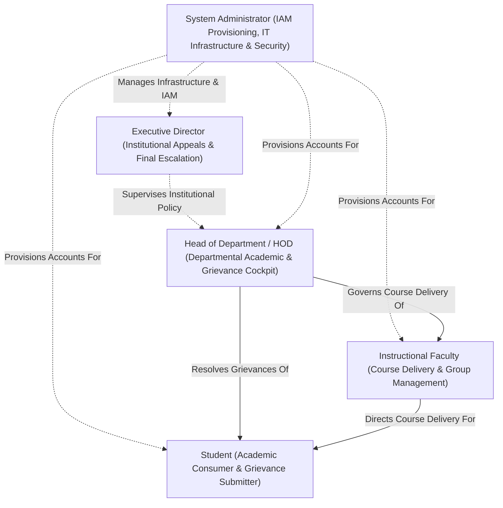

# AXIS LINKUP — ROLE HIERARCHY & PERMISSIONS SPECIFICATION
**Document ID:** DOC-REQ-003-REV2  
**Status:** Approved for Architecture & Workflow Specification (Phase 4.8.2)  
**Institution:** Axis Institute of Technology & Management (AITM), Kanpur  
**Last Updated:** November 13, 2026  

---

## 1. Executive Role Hierarchy & Separation of Powers

To prevent administrative privilege creep and ensure strict collegiate accountability, Axis LinkUp enforces a non-overlapping **Separation of Powers** across administrative leadership.

---

## 2. Granular Role Definitions

### 2.1 System Administrator (`super_admin:sys_admin`)
- **Primary Domain:** IT Infrastructure, IAM Security, Platform Configurations, and Data Integrity.
- **Key Responsibilities:**
  - Provision student, faculty, and administrative accounts.
  - Manage unique usernames, institutional email bindings, and identity lifecycle.
  - Configure institutional platform settings, academic calendar masters, and emergency protocols.
  - Review immutable system audit logs and security telemetry.
- **Strict Boundary:** Does NOT adjudicate academic grievances or handle private student academic appeals by default.

### 2.2 Head of Department — HOD (`admin:hod`)
- **Primary Domain:** Departmental Academic Management, Instructional Oversight, and Level-1 Student Grievance Resolution.
- **Key Responsibilities:**
  - Access department-authorized academic reports, student rosters, and faculty course allocations.
  - Receive formal student complaints and grievances directed to their department.
  - Review, investigate, and post formal responses to department grievances.
  - Escalate unresolved grievances to the Executive Director when academic mediation fails.
- **Strict Boundary:** Does NOT possess System Administrator privileges (cannot provision accounts, cannot modify database schemas, cannot alter platform-wide settings). Scoped strictly to their assigned department (`departmentId`).

### 2.3 Executive Director (`super_admin:director`)
- **Primary Domain:** Institutional Leadership, Executive Governance, and Final Appellate Authority.
- **Key Responsibilities:**
  - Receive formal complaints and petitions addressed directly to the Director.
  - Review escalated grievances forwarded by Department HODs.
  - Adjudicate final institutional decisions and issue binding resolutions.
  - Review campus-wide operational compliance and institutional analytics.
- **Strict Boundary:** Does NOT handle routine IT system provisioning or daily class-level academic assignments.

### 2.4 Instructional Faculty (`faculty`)
- **Primary Domain:** Teaching, Coursework Evaluation, and Class Communication.
- **Key Responsibilities:**
  - Create and moderate course chat channels and discussion groups.
  - Add enrolled students to course groups using registered usernames.
  - Grade coursework, publish notes, and dispatch circulars.
- **Strict Boundary:** Cannot view grievances submitted to HOD or Director; cannot create administrative announcements.

### 2.5 Student (`student`)
- **Primary Domain:** Academic Participation, Learning, and Grievance Ingress.
- **Key Responsibilities:**
  - Participate in faculty-created course groups and authorized peer chats.
  - Submit formal grievances to their Department HOD or College Director via the Grievance Portal.
  - Submit coursework and view academic evaluations.
- **Strict Boundary:** Cannot create public chat groups; cannot view complaints filed by peers; cannot self-register accounts.

---

## 3. Administrative Portal Role Resolution Matrix

When an administrative user selects the **Administration Portal** on the landing page, the server resolves their specific sub-role and routes them to their dedicated workspace:

| Resolved User Identity | Role Attribute | Department Scope | Routed Workspace | Accessible Consoles |
| :--- | :--- | :--- | :--- | :--- |
| **IT Systems Lead** | `super_admin` | Global (`ALL`) | `/super-admin/dashboard` | IAM Provisioning, Audit Logs, Settings |
| **CSE Department HOD**| `admin` | `CSE` Department | `/admin/dashboard` | CSE Student Roster, Grievance Desk (CSE) |
| **ECE Department HOD**| `admin` | `ECE` Department | `/admin/dashboard` | ECE Student Roster, Grievance Desk (ECE) |
| **Executive Director** | `super_admin` | Global (`ALL`) | `/director/dashboard` | Executive Grievance Desk, Director Appeals |

---

## 4. Master CRUD & Operations Matrix (Updated Modules)

**Legend:**
- **C:** Create | **R:** Read | **U:** Update | **D:** Delete
- **App:** Approve / Resolve | **Esc:** Escalate
- **Own:** Restricted strictly to own resources | **Dept:** Scoped strictly to assigned department | **Global:** Full institutional scope
- **— :** Prohibited / No Access

| Module / Operation | Student | Faculty | HOD (`admin`) | System Admin | Director |
| :--- | :---: | :---: | :---: | :---: | :---: |
| **User Account Provisioning** | — | — | — | **C, R, U (Global)** | — |
| **Self Profile View / Update** | R, U (Own) | R, U (Own) | R, U (Own) | R, U (Own) | R, U (Own) |
| **1:1 Peer Direct Chat** | C, R, U (Own) | C, R, U (Own) | C, R, U (Own) | R (Audit Flagged) | R (Audit Flagged) |
| **Faculty Group Creation** | — | **C, R, U (Own)** | **C, R, U (Dept)** | R (Moderation) | R (Moderation) |
| **Group Member Management** | — | **C, U, D (Own Group)**| **C, U, D (Dept)** | D (Force Remove) | — |
| **Submit Formal Grievance** | **C, R (Own)**| — | — | — | — |
| **Review Dept Grievances** | — | — | **R, U, App, Esc (Dept)** | — | — |
| **Review Director Grievances** | — | — | — | — | **R, U, App (Global)** |
| **Platform Configurations** | — | — | — | **C, R, U, D (Global)**| R (View Only) |
| **System Security Audit Logs** | — | — | — | **R, Exp (Global)** | **R, Exp (Global)** |

---

## 5. Prohibited Operations & Access Control Policies

1. **PROHIB-ROLE-01 (No Student Group Creation):** Students are strictly prohibited from creating chat groups or broadcast channels. Group creation is reserved exclusively for instructional faculty and department HODs.
2. **PROHIB-ROLE-02 (Peer Grievance Isolation):** Students are strictly prohibited from viewing, searching, or subscribing to grievances filed by other students. All grievance tickets are confidential.
3. **PROHIB-ROLE-03 (No Cross-Department HOD Visibility):** Department HODs are strictly prohibited from viewing grievances or academic records belonging to other departments.
4. **PROHIB-ROLE-04 (No Administrative Self-Promotion):** HODs and faculty accounts cannot escalate their own roles or provision new user accounts.

