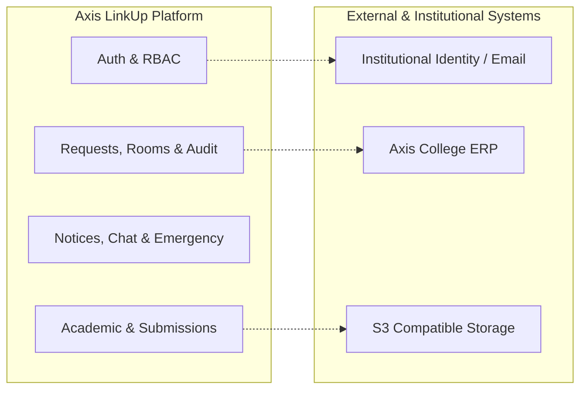

# Software Requirements Specification (SRS)
## Axis LinkUp — College Communication & Productivity Platform

> **Document ID:** DOC-REQ-002  
> **Standard:** Aligned with IEEE 830 / ISO/IEC/IEEE 29148  
> **Status:** Draft for Review (Phase 1, Part 1.1)  
> **Institution:** Axis Institute of Technology & Management  
> **Release Target:** Version 1.0 (MVP) through Version 3.0  

---

## 1. Introduction

### 1.1 Purpose
This document specifies the software requirements for **Axis LinkUp**, the unified digital communication and productivity platform for Axis Institute of Technology & Management. It provides an authoritative baseline for software engineers, database designers, UI/UX developers, and project managers involved in building, testing, and deploying the platform.

### 1.2 Scope
Axis LinkUp is a web-based institutional ecosystem connecting Students, Faculty, Administrators, and Super Administrators. The system encompasses 19 core functional modules covering authentication, role-based access control, role-specific dashboards, targeted notices, real-time messaging, academic scheduling, assignment submissions, digital study materials, service request tracking, room/lab occupancy discovery, student skill passport, emergency overrides, alerts, analytics, and immutable audit logs.

### 1.3 Definitions, Acronyms, and Abbreviations
- **AITM:** Axis Institute of Technology & Management.
- **RBAC:** Role-Based Access Control.
- **JWT:** JSON Web Token.
- **SLA:** Service Level Agreement (for administrative request resolution).
- **PWA:** Progressive Web Application.
- **SSR / SSG:** Server-Side Rendering / Static Site Generation.
- **Audit Log:** An append-only, tamper-resistant record of system transactions and administrative actions.
- **Emergency Mode:** A high-priority system state triggered by designated campus authorities that broadcasts urgent directives and overrides standard UI notifications.
- **Passport:** A verified digital profile of a student's technical skills, certifications, club memberships, and extracurricular milestones.
- **DPDP Act:** Digital Personal Data Protection Act (India, 2023).

### 1.4 References
- IEEE Std 830-1998, Recommended Practice for Software Requirements Specifications.
- W3C Web Content Accessibility Guidelines (WCAG) 2.1, Level AA.
- Digital Personal Data Protection Act (DPDP Act, 2023 - India).
- Axis Institute of Technology & Management Academic Regulations and Code of Conduct.

---

## 2. Overall Description

### 2.1 Product Perspective
Axis LinkUp is a new, standalone web platform designed to replace legacy manual and uncoordinated digital workflows. While independent, it is designed with future integration hooks for institutional ERPs, single sign-on (SSO) providers, and cloud document repositories.

### 2.2 Product Functions (High-Level Summary)
The platform delivers the following primary functional capabilities:
1. **Identity & Authorization:** Authenticate users via institutional credentials with strict role isolation (Student, Faculty, Admin, Super Admin).
2. **Targeted Information Distribution:** Filtered college notices with priority tags, acknowledgment tracking, and read receipts.
3. **Synchronous & Asynchronous Communication:** Departmental group channels, course-based discussion threads, and direct peer/faculty messaging.
4. **Academic Operations:** Centralized academic calendar, assignment distribution and file submission with deadline enforcement, and lecture notes sharing.
5. **Campus Administration:** Digital ticket lifecycle management for student requisitions (bonafide, leave, lab access, etc.) with SLA tracking.
6. **Campus Resource Discovery:** Real-time visibility into classroom and laboratory occupancy and equipment specs.
7. **Student Milestone Verification:** Faculty-endorsed digital skill passport showcasing extracurricular and academic credentials.
8. **Institutional Governance & Safety:** Instant campus-wide emergency broadcasting, operational analytics, and immutable audit logs.

### 2.3 User Classes and Characteristics
- **Students (approx. 3,000–5,000 users):** High mobile usage, tech-literate, primary consumers of notices, assignments, notes, and request services.
- **Faculty (approx. 150–250 users):** Mixed mobile/desktop usage, creators of course content, notices, assignments, and validators of student achievements.
- **Departmental & Central Admins (approx. 20–40 users):** Primarily desktop users, operators of request queues, notice approvals, room schedules, and student records.
- **Super Administrators (approx. 2–5 users):** IT directors and college leadership requiring full oversight of system security, role assignments, audit logs, and emergency broadcasts.

### 2.4 Operating Environment
- **Server Platform:** Node.js runtime environment (LTS version) running a Next.js App Router application.
- **Database Engine:** PostgreSQL 15+ relational database with connection pooling.
- **Caching & WebSockets:** Redis 7+ for session management, rate-limiting, and real-time message pub/sub.
- **Client Platforms:** Modern evergreen web browsers (Google Chrome 110+, Mozilla Firefox 110+, Apple Safari 16+, Microsoft Edge 110+) across Desktop, Tablet, and Mobile devices (iOS & Android).

### 2.5 Design and Implementation Constraints
- **Language & Framework:** Modern TypeScript across frontend and backend (Next.js).
- **Stateless Application Tier:** All state must reside in PostgreSQL, Redis, or Object Storage to allow horizontal container scaling.
- **No Direct Plaintext Credentials:** Passwords must be hashed using Argon2id or bcrypt (cost factor >= 12).
- **Data Residence:** All institutional and student data must comply with Indian data residency mandates under the DPDP Act.

### 2.6 Assumptions and Dependencies
- Each user will have a valid institutional or personal email address verified during account registration or provisioned via admin import.
- The college will provide reliable internet infrastructure within campus labs and administrative offices.
- Third-party cloud object storage (e.g., AWS S3 or MinIO) will be available for persistent binary asset storage (PDFs, images, ZIP files).

---

## 3. External Interface Requirements

### 3.1 User Interfaces (UI)
- **Design System:** Responsive, component-driven UI utilizing modern CSS utility frameworks with dark/light mode capability.
- **Form Validation:** Real-time client-side validation with definitive server-side validation using schema-based validators (e.g., Zod).
- **Feedback & States:** Explicit loading skeletons, empty states, error boundaries, and non-blocking toast notifications.
- **Emergency UI:** Unmistakable, full-width, high-contrast banner with flashing or pulsing indicators when Emergency Mode is active.

### 3.2 Hardware Interfaces
- The web application requires no specialized hardware. Camera/file storage on mobile devices and desktops may be accessed through standard HTML5 file input APIs for document uploads and profile images.

### 3.3 Software Interfaces
- **Database Interface:** Managed via a type-safe Object Relational Mapper (ORM) targeting PostgreSQL.
- **File Storage Interface:** S3-compatible API protocol for uploading, streaming, and generating time-limited signed URLs for assignment files and study resources.
- **Notification Services:** Web Push Notification API, SMTP email gateway for transactional emails, and future webhook/SMS connectors.

### 3.4 Communications Interfaces
- **HTTP/HTTPS:** Enforced HTTPS with TLS 1.3 for all REST API endpoints and Server Actions.
- **WebSockets / Server-Sent Events (SSE):** WSS protocol for real-time messaging, live notification delivery, and instant emergency broadcast pushes.

---

## 4. System Features & Functional Specifications

Detailed specifications for each of the 19 individual modules are documented in `FEATURE_MODULES.md`. The high-level functional traceability matrix is summarized below:

| Module Code | Module Name | Primary Role(s) | Critical MVP Requirement? |
| :--- | :--- | :--- | :--- |
| **MOD-01** | Authentication & User Management | All Roles | **Yes (MVP Core)** |
| **MOD-02** | Role-Based Access Control (RBAC) | All Roles | **Yes (MVP Core)** |
| **MOD-03** | Student Dashboard | Student | **Yes (MVP Core)** |
| **MOD-04** | Faculty Dashboard | Faculty | **Yes (MVP Core)** |
| **MOD-05** | Admin Dashboard | Admin | **Yes (MVP Core)** |
| **MOD-06** | Super Admin Dashboard | Super Admin | **Yes (MVP Core)** |
| **MOD-07** | College Notices | All Roles | **Yes (MVP Core)** |
| **MOD-08** | Real-Time Chat & Groups | All Roles | **Partial (MVP Basic)** |
| **MOD-09** | Polls & Voting | Faculty, Admin, Student | No (Version 2) |
| **MOD-10** | Academic Calendar | All Roles | **Yes (MVP Core)** |
| **MOD-11** | Assignments & Submissions | Faculty, Student | No (Version 2) |
| **MOD-12** | Notes & Study Materials | Faculty, Student | No (Version 2) |
| **MOD-13** | Student Request Tracker | Student, Admin, Faculty | **Yes (MVP Core)** |
| **MOD-14** | Room and Lab Finder | All Roles | No (Version 2) |
| **MOD-15** | Skill & Achievement Passport | Student, Faculty, Admin | No (Advanced - V3) |
| **MOD-16** | Emergency Mode | Super Admin, Admin, All | No (Advanced - V3) |
| **MOD-17** | Notifications | All Roles | **Yes (MVP Core In-App)** |
| **MOD-18** | Analytics & Reports | Admin, Super Admin | No (Version 2 / V3) |
| **MOD-19** | Audit Logs | Super Admin, Admin | **Yes (MVP Core Security)** |

---

## 5. Non-Functional Requirements (NFRs)

### 5.1 Security Requirements
- **NFR-SEC-01 (Authentication Security):** Passwords must enforce a minimum length of 8 characters, containing uppercase, lowercase, numbers, and special symbols. Hashed using Argon2id or bcrypt (cost >= 12).
- **NFR-SEC-02 (Session Integrity):** Authentication tokens (JWT / Session IDs) must be stored exclusively in `HttpOnly`, `Secure`, `SameSite=Strict` cookies. Refresh tokens must be rotated upon use.
- **NFR-SEC-03 (Authorization Checks):** Every Server Action and API endpoint must re-evaluate user role, permissions, and entity ownership on the server side prior to executing read or mutation logic.
- **NFR-SEC-04 (Injection & Sanitization):** All SQL queries must be parameterized via the ORM. All user-submitted rich text/markdown must be sanitized against cross-site scripting (XSS) using DOMPurify or equivalent prior to rendering.
- **NFR-SEC-05 (File Upload Protection):** File uploads must be validated for MIME type, file extension, and binary magic bytes. Files must be scanned for malicious payloads and restricted to designated file size limits (e.g., max 25MB for assignments, 50MB for lecture notes). Direct public execution of uploaded files must be prevented via non-executable cloud bucket permissions.
- **NFR-SEC-06 (Rate Limiting):** Public endpoints (Login, Password Reset, Request Submission) must be protected by IP and account rate limiters (e.g., max 5 failed login attempts per minute before temporary lock out).

### 5.2 Performance Requirements
- **NFR-PERF-01 (Initial Page Load):** First Contentful Paint (FCP) must complete within `<= 1.2 seconds` on desktop and `<= 1.8 seconds` on standard 4G mobile connections.
- **NFR-PERF-02 (API Response Time):** 95% of standard read API queries must return within `<= 200 ms`. Complex aggregated reporting queries must complete within `<= 1.5 seconds`.
- **NFR-PERF-03 (Real-Time Latency):** Chat messages and in-app notifications must be dispatched to online recipients within `<= 150 ms` under standard network conditions.
- **NFR-PERF-04 (Database Optimization):** Common queries (notices feed, student requests, timetable) must use indexed lookups with query execution times `<= 50 ms`.

### 5.3 Scalability Requirements
- **NFR-SCAL-01 (Concurrent Users):** The architecture must support a baseline of 1,000 concurrent active users during normal operational hours, with elasticity to handle burst loads of 5,000 concurrent users during peak events (e.g., exam timetable release, emergency alerts).
- **NFR-SCAL-02 (Stateless Scalability):** The application server layer must be horizontally scalable behind a load balancer without sticky sessions.
- **NFR-SCAL-03 (Storage Growth):** The file storage subsystem must handle scalable volume growth up to 1 Terabyte of student submissions and academic materials per academic year.

### 5.4 Reliability & Availability Requirements
- **NFR-REL-01 (Uptime SLA):** The platform must maintain 99.9% uptime during standard academic semesters (excluding planned maintenance windows scheduled during off-peak hours).
- **NFR-REL-02 (Data Persistence & Backups):** The primary database must have automated daily snapshots and point-in-time recovery (PITR) enabled with a Recovery Point Objective (RPO) of `<= 1 hour` and a Recovery Time Objective (RTO) of `<= 4 hours`.
- **NFR-REL-03 (Graceful Degradation):** If the real-time WebSocket connection drops, the client must seamlessly fall back to short polling or display a non-obtrusive reconnection banner without terminating user workflow.

### 5.5 Accessibility Requirements
- **NFR-ACC-01 (Standards Compliance):** The web user interface must comply with W3C Web Content Accessibility Guidelines (WCAG) 2.1 Level AA standards.
- **NFR-ACC-02 (Keyboard Navigability):** All interactive elements (menus, modals, form inputs, buttons) must be fully navigable via standard keyboard controls (`Tab`, `Shift+Tab`, `Enter`, `Escape`).
- **NFR-ACC-03 (Screen Readers):** Semantic HTML5 elements (`<header>`, `<main>`, `<nav>`, `<article>`) must be used, accompanied by descriptive `aria-label` attributes on icon-only buttons.
- **NFR-ACC-04 (Color Contrast):** Text and UI controls must maintain a minimum contrast ratio of `4.5:1` against their background.

### 5.6 Responsiveness & Cross-Browser Requirements
- **NFR-RESP-01 (Responsive Breakpoints):** The layout must fluidly adapt to standard viewports:
  - Mobile Small: 360px – 480px
  - Tablet: 768px – 1023px
  - Desktop: 1024px – 1440px
  - Ultra-wide: 1440px+
- **NFR-RESP-02 (Touch Ergonomics):** Touch targets on mobile interfaces must meet a minimum size of 44x44 pixels.
- **NFR-RESP-03 (Browser Compatibility):** Complete visual and functional parity across Chrome, Firefox, Safari, and Edge on the last two major releases.

### 5.7 Maintainability & Code Quality Requirements
- **NFR-MAINT-01 (Strict Typing):** 100% of the codebase must be written in TypeScript with `strict: true` compiler configuration; usage of `any` is strictly discouraged.
- **NFR-MAINT-02 (Code Modularity):** Clear separation of concerns following domain-driven or feature-sliced structure (presentation components, hooks, services, database repositories).
- **NFR-MAINT-03 (Documentation):** Every major module, service function, and API contract must be documented with JSDoc and corresponding OpenAPI/Zod schema definitions.
- **NFR-MAINT-04 (Automated Testing):** Core business logic (auth guards, request state transitions, grading logic) must maintain unit and integration test coverage targets (`>= 80%`).

### 5.8 Data Privacy & Institutional Governance Requirements
- **NFR-PRIV-01 (Compliance with DPDP Act):** All personally identifiable information (PII) including student contact details, national ID numbers, and grades must be encrypted at rest (AES-256) and in transit (TLS 1.3).
- **NFR-PRIV-02 (Right to Erasure & Export):** Support administrative capability to export a student's complete academic record and securely anonymize or purge data upon student graduation after the institutional retention window expires.
- **NFR-PRIV-03 (Phone Number Concealment):** Personal phone numbers of students and faculty members must never be displayed in public profiles or chat room headers.

---

## 6. Verification & Acceptance Criteria

| ID | Feature / Quality Area | Acceptance Criteria | Verification Method |
| :--- | :--- | :--- | :--- |
| **AC-01** | Role-Based Access Control | A Student user attempting to access `/admin/*` or `/faculty/*` routes is immediately redirected with a 403 Forbidden status. | Automated Integration Test & Manual Penetration Test |
| **AC-02** | Notice Targeting | A notice published for "Computer Science - 3rd Year" is visible only to CS-Year 3 students and faculty, and is hidden from Mechanical Engineering students. | User Acceptance Test (UAT) with seeded multi-dept accounts |
| **AC-03** | Assignment Submission Deadline | A student attempting to upload a submission 1 minute past the hard deadline is blocked unless late submissions are explicitly enabled by the faculty. | Automated End-to-End Test (Playwright) |
| **AC-04** | Request Status Workflow | A submitted request changes status to "Under Review" upon Admin assignment, and emits an instant in-app notification to the student. | End-to-End Integration Test |
| **AC-05** | Emergency Broadcast Override | Triggering Emergency Mode forces an active banner across all connected clients within 3 seconds, requiring explicit acknowledgment. | Load & Latency Testing with simulated WebSocket clients |
| **AC-06** | Audit Trail Verification | Any modification to user roles, notice deletion, or ticket status change produces an unalterable log record with timestamp, user ID, and IP address. | Database Inspection & Security Audit Review |
| **AC-07** | Mobile Responsiveness | All primary student and faculty flows complete without horizontal scrolling or broken layouts on a 375px mobile viewport. | Browser Device Emulation & Physical Device QA |

