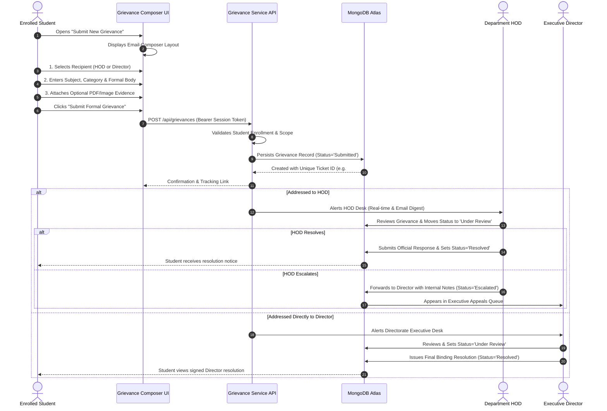
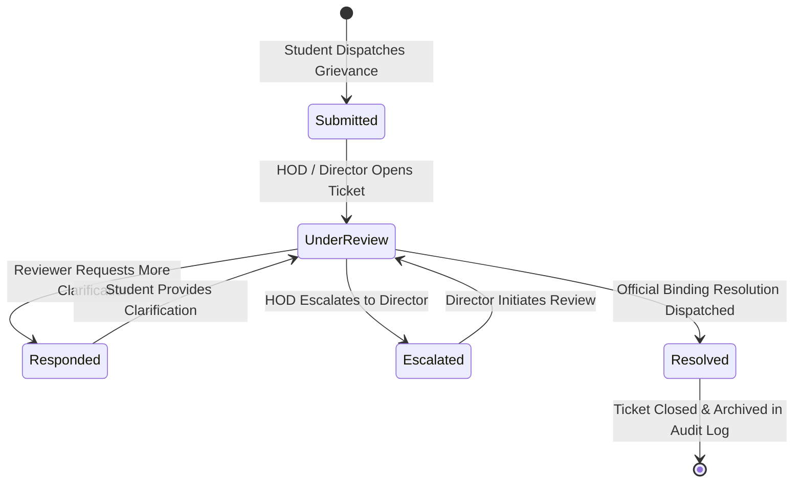

# AXIS LINKUP — STUDENT GRIEVANCE & COMPLAINT WORKFLOW
**Document ID:** DOC-REQ-013-REV2  
**Status:** Approved for Architecture & Workflow Specification (Phase 4.8.2)  
**Institution:** Axis Institute of Technology & Management (AITM), Kanpur  
**Last Updated:** November 13, 2026  

---

## 1. Module Naming & Statutory Institutional Context

### 1.1 Recommended Naming: **Student Grievance Portal**
While informally referred to as "Complaints", the formal recommended title for this module across Axis LinkUp is:

$$\mathbf{Student\ Grievance\ Portal\ (Grievance\ \&\ Executive\ Appeals\ Desk)}$$

### Rationale:
1. **Accreditation & Statutory Compliance:** The University Grants Commission (UGC) and All India Council for Technical Education (AICTE) mandate a formal *"Student Grievance Redressal Committee (SGRC)"* for technical institutions. Using the term **Grievance Portal** aligns directly with institutional audit standards.
2. **Professionalism & Tone:** Framing the interface as a formal Grievance & Executive Appeals Desk elevates the seriousness of submissions, discouraging frivolous messages while providing a secure whistle-blower and dispute resolution channel.

---

## 2. Ingress & Communication Flow



---

## 3. Composer Interface Specification

The submission interface is styled as a **clean, professional email composer** utilizing the approved light-blue Glassmorphism design system:

```text
┌──────────────────────────────────────────────────────────────────────────────────────────────────┐
│  COMPOSE FORMAL GRIEVANCE / APPEAL                                                       [X]     │
│ ┌──────────────────────────────────────────────────────────────────────────────────────────────┐ │
│ │ TO:          (•) Head of Department (CSE)       ( ) Executive Director (Campus-Wide)         │ │
│ ├──────────────────────────────────────────────────────────────────────────────────────────────┤ │
│ │ CATEGORY:    [ Academic Curriculum & Teaching Evaluation                       ▼ ]           │ │
│ ├──────────────────────────────────────────────────────────────────────────────────────────────┤ │
│ │ SUBJECT:     [ Issue regarding Semester 5 Lab Equipment Calibration in Lab 302             ] │ │
│ ├──────────────────────────────────────────────────────────────────────────────────────────────┤ │
│ │                                                                                              │ │
│ │ MESSAGE      Respected Head of Department,                                                   │ │
│ │ BODY:                                                                                        │ │
│ │              I am writing to formally bring to your attention that the oscilloscopes in      │ │
│ │              Electronics Lab 302 have experienced recurring power calibration faults...      │ │
│ │                                                                                              │ │
│ │                                                                                              │ │
│ ├──────────────────────────────────────────────────────────────────────────────────────────────┤ │
│ │ ATTACHMENTS: [ + Attach Document or Evidence (PDF, PNG, JPG - Max 10MB) ]                    │ │
│ │              [ lab_log_sheet.pdf (1.2 MB)  (x) ]                                             │ │
│ ├──────────────────────────────────────────────────────────────────────────────────────────────┤ │
│ │ [✓] I certify that this grievance is genuine and conforms to AITM institutional conduct.     │ │
│ │                                                [ Save Draft ]   [ Submit Formal Grievance ]  │ │
│ └──────────────────────────────────────────────────────────────────────────────────────────────┘ │
└──────────────────────────────────────────────────────────────────────────────────────────────────┘
```

### 3.1 Submission Form Fields
1. **Recipient Selector (Radio Button Pill):**
   - Option A: `Head of Department (<Student's Dept Code>)` — e.g., Head of Computer Science & Engineering.
   - Option B: `Executive Director (Campus-Wide Appeals)`.
2. **Grievance Category (Dropdown):**
   - `Academic & Curriculum Delivery`
   - `Examination & Internal Evaluations`
   - `Laboratory Facilities & Computing Equipment`
   - `Harassment, Ragging & Conduct Grievance` (High Priority)
   - `Hostel, Canteen & Infrastructure Services`
   - `Fee Clearance & Administrative Requisitions`
3. **Subject Line:** Single-line text input (10 to 150 characters).
4. **Detailed Statement (Body):** Multi-line formatted textarea (50 to 5,000 characters).
5. **Supporting Proof / Attachment:** Presigned upload supporting PDF and images.
6. **Author Verification Checkbox:** Mandatory confirmation under institutional student conduct code.

---

## 4. Lifecycle Status Progression & Rules

Every grievance progresses through strict lifecycle stages:



### 4.1 Status Definitions

| Status Code | Display Label | Badge Styling | Meaning |
| :--- | :--- | :--- | :--- |
| `submitted` | **Submitted** | `variant="info"` (Blue) | Successfully received by server; awaiting reviewer action. |
| `under_review` | **Under Review**| `variant="warning"` (Amber) | Reviewer has opened and begun active investigation. |
| `responded` | **Responded** | `variant="glass"` (Teal) | Reviewer sent an intermediate inquiry to the student. |
| `escalated` | **Escalated** | `variant="destructive"` (Rose)| HOD forwarded ticket to the Executive Director for arbitration. |
| `resolved` | **Resolved** | `variant="success"` (Emerald)| Official resolution delivered; ticket formally concluded. |

---

## 5. Confidentiality, Privacy & Anti-Impersonation Safeguards

1. **Strict Server-Side Identity Binding:**
   - The student's identity (`studentId`, `rollNumber`, `email`, `departmentId`) is pulled directly from the verified Server Session (`requireRole('student')`).
   - The client cannot supply or forge another student's identity.
2. **Access Isolation Gates:**
   - **Student Isolation:** `requireResourceOwnership(grievance.studentId)` ensures students can only read and query their own grievances.
   - **HOD Scope Isolation:** HODs can only query grievances where `departmentId === hod.departmentId && recipient === 'hod'`. Cross-department reading is rejected with `403 Forbidden`.
   - **Director Oversight:** Directors can access all grievances addressed directly to the Director or marked as `escalated`.
3. **Internal Administrative Notes:**
   - HODs and the Director can append internal consultation notes (`internalNotes`) that are visible only to administrative reviewers and hidden from the student view.
4. **Tamper-Proof Audit Trail:**
   - Every status transition, note addition, and document view is permanently appended to the ticket's `timelineEvents` array with timestamps and actor IDs.

