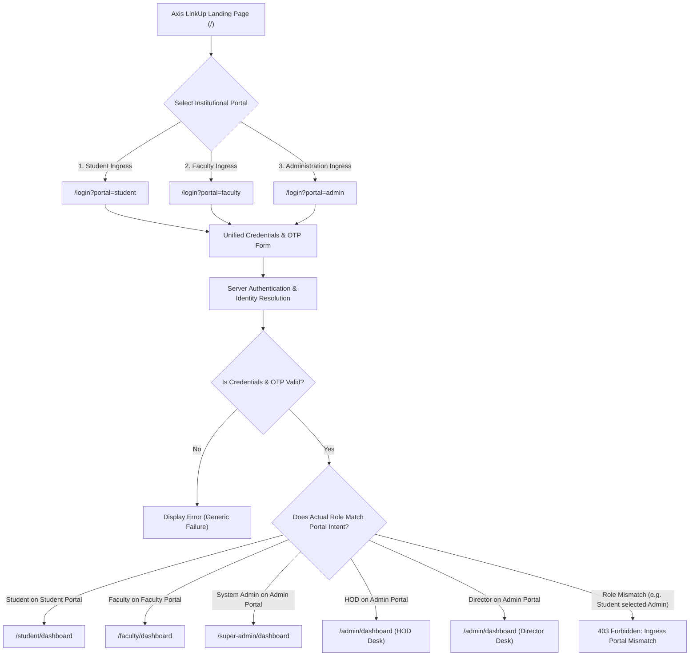

# AXIS LINKUP — UPDATED AUTHENTICATION REQUIREMENTS
**Document ID:** DOC-REQ-001-REV2  
**Status:** Approved for Architecture & Workflow Specification (Phase 4.8.2)  
**Institution:** Axis Institute of Technology & Management (AITM), Kanpur  
**Last Updated:** November 13, 2026  

---

## 1. Executive Summary & Policy Paradigm Shift

Following executive review of campus operational security and institutional governance policies, the authentication model of Axis LinkUp has shifted from **hybrid self-registration** to a **strictly closed, administrator-provisioned, three-tier ingress architecture**.

### Core Policy Directives:
1. **Elimination of Public Self-Registration:** Public `Sign Up` and self-service `Student Registration` routes (`/sign-up`) are **permanently removed**. Ordinary students, faculty, and external visitors cannot create accounts.
2. **Mandatory Administrative Ingress Provisioning:** All accounts must be explicitly provisioned by authorized System Administrators through institutional workflows.
3. **Three Distinct Ingress Options:** The landing page provides three clear entry doors: **Student**, **Faculty**, and **Administration**.
4. **Unified Identity Underneath:** All three doors authenticate against a single, shared institutional identity directory. The same registered username or institutional email functions across the platform.
5. **Role Selector as Routing Choice (Zero Trust):** The entry selector on the landing page is strictly a **login-routing intent signal**, NOT an authorization bypass or permission granter. The server strictly verifies the account's authentic role and permissions before granting dashboard access.

---

## 2. Ingress Entry Architecture: The Three Portals

### 2.1 The Three Entry Portals Defined

| Portal Entry | Permitted Target Roles | Intended Audience | Destination Workspace |
| :--- | :--- | :--- | :--- |
| **Student** | `student` | Enrolled undergraduate and postgraduate students | `/student/dashboard` |
| **Faculty** | `faculty` | Instructional professors, lecturers, lab instructors | `/faculty/dashboard` |
| **Administration** | `admin` (HOD), `super_admin` (Sys Admin, Director) | Department Heads, System Administrators, College Director | Scoped `/admin/dashboard` or `/super-admin/dashboard` |

---

## 3. Login Workflow & Field Requirements

### 3.1 Input Form Specification
Regardless of the selected entry portal, the login interface presents standardized, high-assurance inputs:

1. **Identifier Field:**
   - Accepts either the **Unique Username** (e.g., `prashant.umrao`, `dr.verma`) OR the **Registered Institutional Email** (`student@axiscolleges.in`, `faculty@axiscolleges.in`).
   - Placeholder: `Username or institutional email`.
   - Client-side validation: Required, trimmed, sanitized, maximum 100 characters.
2. **Password Field:**
   - Password established during account activation.
   - Masked input with secure show/hide toggle.
3. **One-Time Password (OTP) Verification Field:**
   - Presented according to the approved authentication workflow (e.g., step-up verification upon credential validation or email-bound OTP code).
   - 6-digit numeric input with auto-focus and auto-advance.
4. **Action Submission:**
   - Primary pill button: `Sign In to Portal`.

---

## 4. Server-Side Role Verification & Cross-Role Ingress Matrix

Under the Zero-Trust Architecture, the client-provided portal selection is treated as an **untrusted assertion**. The server enforces the following strict access rules:

### 4.1 Cross-Role Ingress Enforcement Matrix

| Actual User Account Role | Selected: Student Portal | Selected: Faculty Portal | Selected: Administration Portal |
| :--- | :--- | :--- | :--- |
| **Student** (`student`) | **ALLOW** $\rightarrow$ `/student/dashboard` | **DENY (403)** $\rightarrow$ Access Forbidden | **DENY (403)** $\rightarrow$ Access Forbidden |
| **Faculty** (`faculty`) | **DENY (403)** $\rightarrow$ Access Forbidden | **ALLOW** $\rightarrow$ `/faculty/dashboard` | **DENY (403)** $\rightarrow$ Access Forbidden |
| **HOD** (`admin`) | **DENY (403)** $\rightarrow$ Access Forbidden | **DENY (403)** $\rightarrow$ Access Forbidden | **ALLOW** $\rightarrow$ `/admin/dashboard` (HOD Scope) |
| **Director** (`super_admin` / Director) | **DENY (403)** $\rightarrow$ Access Forbidden | **DENY (403)** $\rightarrow$ Access Forbidden | **ALLOW** $\rightarrow$ `/admin/dashboard` (Director Scope) |
| **System Administrator** (`super_admin`) | **ALLOW (Audit Flag)** $\rightarrow$ Read-only Impersonation | **ALLOW (Audit Flag)** $\rightarrow$ Read-only Impersonation | **ALLOW** $\rightarrow$ `/super-admin/dashboard` |

### 4.2 Rejection & Redirection Logic
- If a **Student** selects the **Administration** portal and enters valid credentials:
  - The server authenticates the identity.
  - The server compares `account.role` (`student`) against the target portal intent (`admin`).
  - The server **blocks entry** with an explicit error: `"Access Denied: Your account role (Student) is not authorized for the Administration Portal."`
  - The event is logged in the security audit stream (`AUDIT_INGRESS_PORTAL_MISMATCH`).
- If a **Faculty** member attempts to enter the **Student** portal:
  - The server blocks entry with: `"Access Denied: Faculty accounts must authenticate through the Faculty Portal."`

---

## 5. Elimination of Public Registration Surface

The following public endpoints and UI surfaces must be completely decommissioned:

1. **Routes Removed from Public Access:**
   - `/sign-up` and `/sign-up/[[...sign-up]]` $\rightarrow$ Redirect to `/` with a 404/307 status.
   - Public registration links on the landing page (`src/app/page.tsx`) $\rightarrow$ Removed.
   - Clerk `<SignUp />` component $\rightarrow$ Removed from public rendering.
2. **API Protection:**
   - Clerk dashboard configuration must have `Sign-up` disabled for the public application instance.
   - Public self-registration API requests must return `HTTP 403 Forbidden` (`REGISTRATION_DISABLED`).

---

## 6. Authentication Provider Compatibility (Clerk Integration)

To satisfy the requirement of avoiding custom password implementations while supporting username-or-email authentication:

1. **Clerk Identification Strategy:**
   - In Clerk Dashboard $\rightarrow$ **User & Authentication** $\rightarrow$ **Email, Phone, Username**:
     - `Email address`: Required for authentication & verification.
     - `Username`: Required, unique, alphanumeric with periods/underscores.
     - `Authentication factors`: Password + Email verification code (OTP).
2. **Clerk Sign-In Component Adaptation:**
   - The Clerk `<SignIn />` component natively supports `identifier` as either `username` or `emailAddress`.
   - The selected portal (`student`, `faculty`, `admin`) is passed as a query parameter or custom context to enforce the downstream server role gate.
3. **Password Security:**
   - Passwords are encrypted, salted, and stored exclusively within Clerk's SOC-2 Type II infrastructure.
   - MongoDB **never** stores password hashes or plaintext secrets.

---

## 7. Compliance & Audit Logging

Every authentication attempt across all three portals must record the following immutable audit parameters:
- `timestamp`: UTC ISO-8601 timestamp.
- `identifier`: Username or email attempted (redacted if non-existent).
- `portalSelected`: `student` | `faculty` | `admin`.
- `resolvedRole`: Actual account role from MongoDB/Clerk.
- `ingressStatus`: `SUCCESS` | `CREDENTIAL_FAILURE` | `ROLE_MISMATCH_BLOCKED` | `ACCOUNT_LOCKED`.
- `ipAddress`: Client IP address.
- `userAgent`: Client browser signature.

