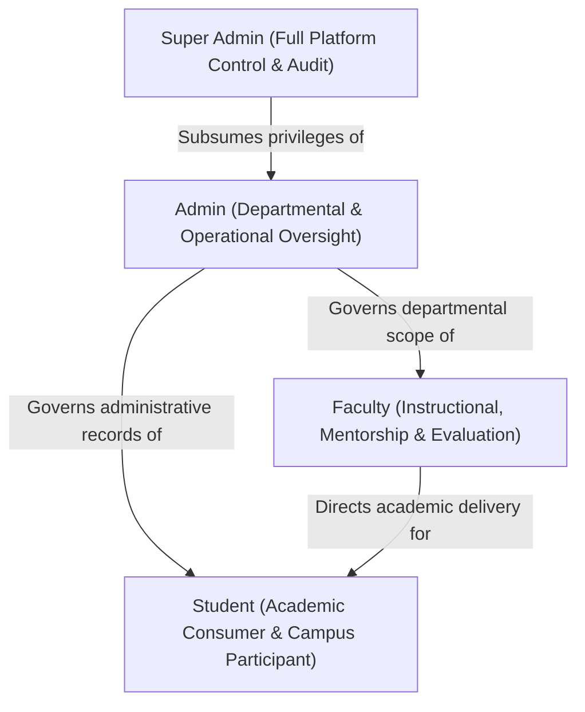
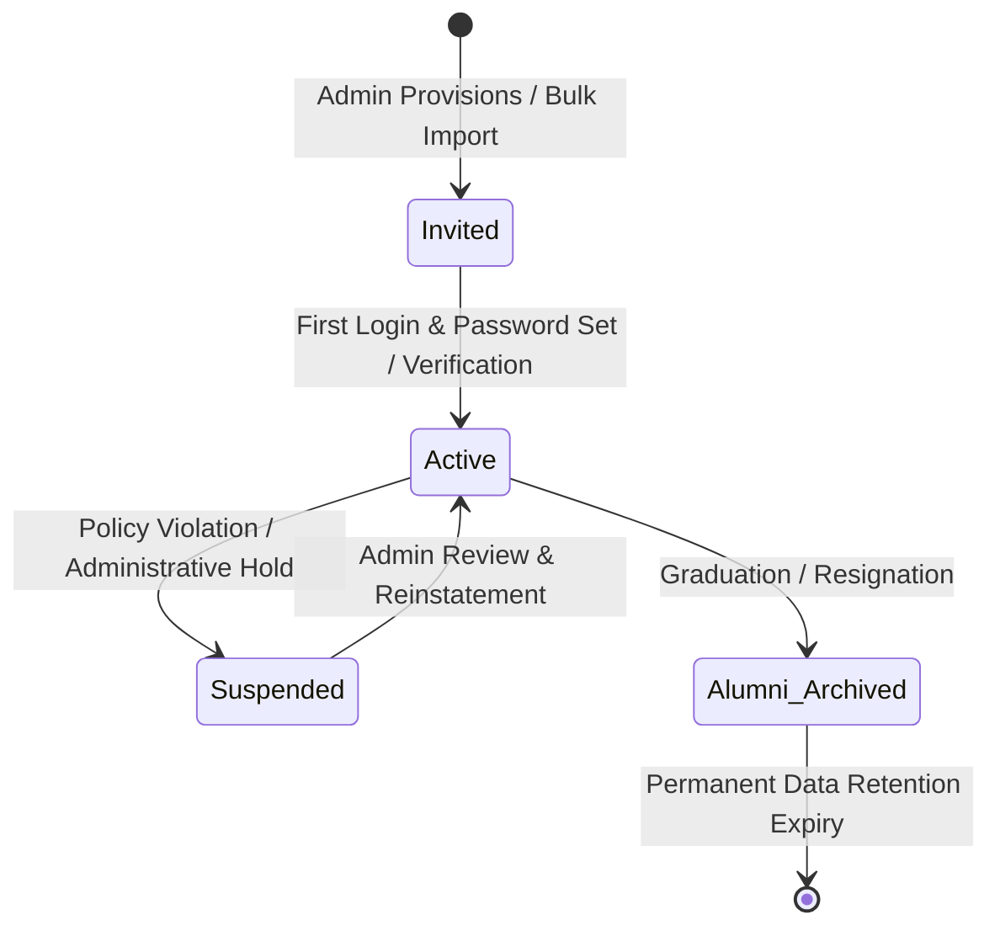

# User Roles and Permissions Specification

> **Document ID:** DOC-REQ-003  
> **Status:** Draft for Review (Phase 1, Part 1.1)  
> **Institution:** Axis Institute of Technology & Management  
> **Last Updated:** November 2026  

---

## 1. Overview & Principle of Least Privilege

Axis LinkUp enforces strict Role-Based Access Control (RBAC) across four core user roles. Every operational action (Create, Read, Update, Delete, Approve, Export, Broadcast) is evaluated against the authenticated user's active role, departmental scope, and entity ownership.

The system strictly abides by the **Principle of Least Privilege (PoLP)**: users are granted only the minimum levels of access necessary to complete their academic, instructional, or administrative responsibilities.

---

## 2. Comprehensive Role Definitions

### 2.1 Student
- **Description:** Enrolled undergraduate or postgraduate students across all academic branches of Axis Institute of Technology & Management.
- **Core Focus:** Consuming official notices, attending scheduled academic activities, submitting assignments, accessing lecture resources, tracking administrative requests, discovering campus spaces, and logging co-curricular achievements.
- **Typical Access Pattern:** Mobile-heavy (85%+ via smartphones), intermittent throughout the day, spikes during exam periods, assignment deadlines, and morning timetable checks.
- **Scope Restriction:** Strictly scoped to their enrolled Department, Degree Program, Batch/Year, and Section. Cannot view private records or submissions of other students.

### 2.2 Faculty
- **Description:** Professors, Associate Professors, Assistant Professors, Visiting Lecturers, and Laboratory Instructors.
- **Core Focus:** Creating and broadcasting course-level notices, posting and evaluating assignments, sharing lecture materials, conducting quick polls, reviewing student milestone endorsements (Skill Passport), and communicating with assigned student batches.
- **Typical Access Pattern:** Balanced Desktop (60%) and Mobile (40%). Active during college hours and grading cycles.
- **Scope Restriction:** Scoped to the specific courses, departments, and laboratory sections assigned to them. Cannot modify administrative records, college-wide operational settings, or system security policies.

### 2.3 Admin (Departmental & Campus Administrator)
- **Description:** Non-teaching administrative staff, Academic Section Officers, Department Coordinators, Registrar Office personnel, and Exam Cell administrators.
- **Core Focus:** Processing and resolving student service requests (bonafide, leaves, ID replacements), maintaining academic calendar schedules, publishing departmental and college-level notices, tracking classroom/lab allocations, and reviewing operational analytics.
- **Typical Access Pattern:** Primarily Desktop (90%+). Continuous active sessions during office hours.
- **Scope Restriction:** Broad operational permissions across departments or centralized campus functions, but strictly restricted from altering core system configurations, modifying audit logs, or escalating user roles without Super Admin approval.

### 2.4 Super Admin (Executive & IT Leadership)
- **Description:** Director, Dean of Academic Affairs, and designated Head of Campus IT Infrastructure.
- **Core Focus:** Global governance of the platform, user lifecycle management, role assignments, system-wide configuration, security policy enforcement, triggering Emergency Mode, accessing immutable audit logs, and reviewing institutional intelligence reports.
- **Typical Access Pattern:** High-security desktop sessions with multi-factor authentication (MFA).
- **Scope Restriction:** Unrestricted system oversight; however, all actions executed by a Super Admin are immutably logged and cannot be erased or modified.

---

## 3. Master CRUD & Operations Matrix (All 19 Modules)

**Legend:**
- **C:** Create | **R:** Read | **U:** Update | **D:** Delete
- **App:** Approve / Reject
- **Exp:** Export Data (CSV/PDF)
- **Brd:** Broadcast System-Wide
- **Own:** Operation restricted strictly to resources owned by the user (or assigned section/dept)
- **— :** Prohibited / No Access

| # | Module Name | Student | Faculty | Admin | Super Admin |
| :-: | :--- | :---: | :---: | :---: | :---: |
| **01** | Authentication & User Management | R (Own Profile), U (Own Profile) | R (Own Profile), U (Own Profile) | C, R, U (Scoped Users) | C, R, U, D (All Users & Roles) |
| **02** | Role-Based Access Control (RBAC) | — | — | R (Role directory) | C, R, U, D (Roles & Permissions) |
| **03** | Student Dashboard | R (Own Personal View) | — | — | — |
| **04** | Faculty Dashboard | — | R (Own Academic View) | — | — |
| **05** | Admin Dashboard | — | — | R (Operational Queue) | R (Operational Queue) |
| **06** | Super Admin Dashboard | — | — | — | R (Executive & System View) |
| **07** | College Notices | R (Targeted to Batch/Dept) | C, R, U (Own Course/Dept Notices) | C, R, U, D, Exp (College & Dept) | C, R, U, D, Exp, Brd (Global) |
| **08** | Real-Time Chat & Groups | C, R, U, D (Own messages/groups) | C, R, U, D (Course channels & DMs) | R (Moderation), D (Flagged) | R, D (Global Moderation) |
| **09** | Polls & Voting | R, Vote (Targeted polls) | C, R, U, D (Course polls), Exp | C, R, U, D (Campus polls), Exp | C, R, U, D, Exp (Global polls) |
| **10** | Academic Calendar | R (Published events) | R (Events), C (Class schedule) | C, R, U, D (Dept / College events) | C, R, U, D, Exp (Master calendar) |
| **11** | Assignments & Submissions | R, C (Submit files), U (Re-submit) | C, R, U, D (Assignments), Grade, Exp | R (Audit & compliance), Exp | R, Exp (Institutional oversight) |
| **12** | Notes & Study Materials | R, Download (Targeted materials) | C, R, U, D (Own course notes) | R, D (Moderation) | R, D (System cleanup) |
| **13** | Student Request Tracker | C, R (Own tickets), U (Cancel own) | R, App (Faculty-level requests) | R, U, App, Exp (Assigned queues) | R, U, App, Exp (All queues) |
| **14** | Room and Lab Finder | R (Live availability & specs) | R, C (Booking request) | C, R, U, D, App (Schedules & Bookings)| C, R, U, D, App (Master Spaces) |
| **15** | Skill & Achievement Passport | C, R (Own profile), U (Add proofs) | R, App (Verify student claims) | R, App, Exp (Accreditation reports)| R, Exp (Placement & Institutional) |
| **16** | Emergency Mode | R (Mandatory Acknowledgment) | R (Mandatory Acknowledgment) | C, R (Trigger upon authorization) | C, R, U, D, Brd (Master Trigger) |
| **17** | Notifications | R, U (Mark read), Configure own | R, U, Configure own | C, R, U (Dispatch alerts) | C, R, U (Dispatch global alerts) |
| **18** | Analytics & Reports | — | R (Own course analytics) | R, Exp (Departmental analytics) | R, Exp (Institutional analytics) |
| **19** | Audit Logs | — | — | R (Scoped operational logs) | R, Exp (Full tamper-proof logs) |

---

## 4. Explicit Restricted and Prohibited Operations

To maintain institutional compliance and avoid privilege leaks, the following boundaries are strictly enforced:

### 4.1 Student Role Prohibitions
- **PROHIB-STU-01:** Strictly prohibited from publishing college notices or course announcements.
- **PROHIB-STU-02:** Strictly prohibited from viewing or downloading submissions belonging to other students.
- **PROHIB-STU-03:** Strictly prohibited from modifying assignment deadlines, grades, or faculty feedback.
- **PROHIB-STU-04:** Strictly prohibited from changing their own enrollment details (Roll Number, Registered Branch, Batch).
- **PROHIB-STU-05:** Strictly prohibited from accessing or triggering Emergency Mode.
- **PROHIB-STU-06:** Strictly prohibited from viewing audit logs or other users' private contact details.

### 4.2 Faculty Role Prohibitions
- **PROHIB-FAC-01:** Strictly prohibited from modifying global college settings, department structures, or academic calendar term dates.
- **PROHIB-FAC-02:** Strictly prohibited from altering administrative service request statuses outside of assigned faculty endorsements (e.g., cannot approve fee clearance or registrar certificates).
- **PROHIB-FAC-03:** Strictly prohibited from altering another faculty member's assignments, gradebooks, or course materials unless designated as a co-instructor.
- **PROHIB-FAC-04:** Strictly prohibited from escalating their own role or creating administrative user accounts.

### 4.3 Admin Role Prohibitions
- **PROHIB-ADM-01:** Strictly prohibited from altering faculty-assigned grades or academic evaluations.
- **PROHIB-ADM-02:** Strictly prohibited from deleting or modifying system audit logs.
- **PROHIB-ADM-03:** Strictly prohibited from creating or promoting accounts to the `Super Admin` tier without existing Super Admin dual authorization.
- **PROHIB-ADM-04:** Strictly prohibited from disabling global security controls (e.g., rate limiting, authentication policies).

### 4.4 Super Admin Role Guardrails
- **GUARD-SAD-01 (Audit Immutability):** Super Admins can query and export audit logs, but **cannot edit, truncate, or delete** audit records under any circumstances.
- **GUARD-SAD-02 (Self-Demotion / Lockout Prevention):** The system prevents a Super Admin from revoking their own Super Admin privileges if they are the sole active Super Admin in the system.
- **GUARD-SAD-03 (Emergency Override Logging):** Activation and deactivation of Emergency Mode immediately writes an emergency event to persistent storage and alerts all administrative leads.

---

## 5. Multi-Role and Dual-Role Handling Policy

In collegiate environments, certain personnel hold dual responsibilities (e.g., a Senior Professor who is also Head of Department (HOD) or Academic Coordinator).

1. **Primary Role Assignment:** Every account possesses a single primary role (`role_key`: `student`, `faculty`, `admin`, `super_admin`).
2. **Context Switching Mechanism:** For personnel with authorized administrative appointments (e.g., Faculty with HOD duties), the system supports **Role Context Switching** via secure session tokens. 
3. **Execution Context:**
   - While operating in "Faculty Context", their UI reflects classroom workflows and course grading.
   - While operating in "Admin / HOD Context", elevated departmental approval queues and notice broadcast tools are unlocked.
4. **Audit Attribution:** Every audit log event records both the `user_id` and the `active_role_context` at the moment of execution to prevent ambiguity during compliance reviews.

---

## 6. Account Lifecycle and State Machine

### Account States:
1. **Invited / Pending Verification:** Account record created via CSV roster import or manual provisioning. Temporary token generated; user must set a strong password and verify their email.
2. **Active:** Fully operational account with full access to role-authorized modules.
3. **Suspended:** Access revoked immediately by Admin or Super Admin due to disciplinary hold, fee suspension, or credential compromise. All active sessions terminated.
4. **Alumni / Archived:** For graduated students or departed faculty. Downgraded to read-only access for historic transcripts/passport, or archived in accordance with institutional record-retention policy.

---

## 7. Session & Security Constraints per Role

| Parameter | Student | Faculty | Admin | Super Admin |
| :--- | :--- | :--- | :--- | :--- |
| **Idle Session Timeout** | 24 Hours | 8 Hours | 2 Hours | 30 Minutes |
| **Absolute Session Lifetime** | 7 Days | 7 Days | 24 Hours | 12 Hours |
| **Concurrent Sessions Allowed** | Max 3 devices | Max 3 devices | Max 2 devices | Strictly 1 active session |
| **Multi-Factor Auth (MFA)** | Optional (Recommended) | Optional (Recommended) | Mandatory | Mandatory |
| **IP Whitelisting / Anomaly Alert** | Anomaly notification | Anomaly notification | Flag outside campus IP | Flag outside campus IP + MFA prompt |

