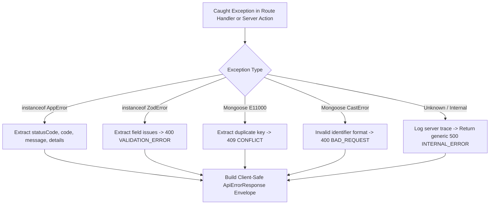

# Axis LinkUp — Core Infrastructure & Shared Utilities Architecture

> **Document ID:** DOC-SETUP-008  
> **Status:** Approved Baseline (Phase 2, Part 2.8)  
> **Institution:** Axis Institute of Technology & Management  
> **Architecture:** Modular Monolith Shared Utilities & Ingress Helpers  
> **Last Updated:** November 2026  

---

## 1. Directory Structure & Layout

The reusable shared infrastructure for Axis LinkUp is organized into focused, single-responsibility modules under `src/lib/`, `src/config/`, and `src/types/`:

```
src/
├── config/
│   ├── constants.ts               # Shared HTTP status codes, pagination defaults, upload limits
│   └── env.ts                     # Runtime validated environment variables and proxy guards
│
├── lib/
│   ├── api/
│   │   ├── api-response.ts        # Next.js API response builders and Server Action payload creators
│   │   ├── api-error-handler.ts   # Centralized error handler mapping exceptions to HTTP envelopes
│   │   └── index.ts               # Unified API ingress exports
│   │
│   ├── errors/
│   │   ├── app-error.ts           # AppError base class and specialized operational error hierarchy
│   │   ├── error-codes.ts         # Standardized error codes and HTTP status code mappings
│   │   └── index.ts               # Unified error exports
│   │
│   ├── logging/
│   │   ├── logger.ts              # Production-safe structured logger with automated secret redaction
│   │   └── index.ts               # Unified logger exports
│   │
│   ├── utils/
│   │   ├── cn.ts                  # Class name merging utility (Tailwind/CSS)
│   │   ├── format-date.ts         # Indian locale date, time, and relative time formatters
│   │   ├── format-number.ts       # Indian currency (INR), number grouping, percentage, compact formatters
│   │   ├── format-file-size.ts    # Human-readable binary file size formatter (Bytes, KB, MB, GB)
│   │   └── index.ts               # Unified browser/server-safe utility exports
│   │
│   ├── validations/
│   │   ├── common-schemas.ts      # Reusable Zod schemas (ObjectId, pagination, roll numbers, search)
│   │   ├── env.schema.ts          # Environment variable validation schema
│   │   └── index.ts               # Unified validation exports
│   │
│   └── utils.ts                   # Root alias re-exporting utils/index for shadcn/ui compatibility
│
└── types/
    ├── api.ts                     # Master API response envelopes (ApiResponse<T>, PaginationMeta)
    ├── common.ts                  # Shared utility types (Nullable, DeepPartial, SortOrder, UserRole)
    └── index.ts                   # Unified shared type exports
```

---

## 2. Shared Utilities & Responsibilities

| File Path | Classification | Environment | Primary Responsibility |
| :--- | :--- | :---: | :--- |
| `src/config/constants.ts` | Configuration | Isomorphic | Authoritative constants: HTTP status codes, pagination limits, allowed MIME types, upload sizes. |
| `src/types/api.ts` | Type Definition | Isomorphic | Pure TypeScript contracts for `ApiResponse<T>`, `ApiSuccessResponse<T>`, `ApiErrorResponse`, `PaginationMeta`. |
| `src/types/common.ts` | Type Definition | Isomorphic | Utility types: `Nullable<T>`, `SortOrder`, `UserRole`, `ObjectIdString`, `ISODateString`. |
| `src/lib/api/api-response.ts` | Ingress Helper | Server-Only | Standardized JSON envelopes for Route Handlers (`NextResponse`) and Server Actions (`createSuccessPayload`). |
| `src/lib/api/api-error-handler.ts` | Error Ingress | Server-Only | Exception normalizer translating `AppError`, `ZodError`, and Mongoose exceptions into safe client responses. |
| `src/lib/errors/app-error.ts` | Error Domain | Isomorphic | `AppError` base class and specialized subclasses (`ValidationError`, `NotFoundError`, `ConflictError`). |
| `src/lib/errors/error-codes.ts` | Error Domain | Isomorphic | Standard error code constants and default HTTP status mappings adhering to DOC-ENG-004. |
| `src/lib/logging/logger.ts` | Observability | Isomorphic | Structured logger with automatic scrubbing of passwords, tokens, API keys, and connection strings. |
| `src/lib/utils/format-date.ts` | Formatting | Isomorphic | Indian English (`en-IN`) date, time, and relative time formatters with defensive fallback handling. |
| `src/lib/utils/format-number.ts` | Formatting | Isomorphic | Indian numbering system grouping, Rupee currency formatting (`₹`), and student percentage calculations. |
| `src/lib/utils/format-file-size.ts`| Formatting | Isomorphic | Binary byte count formatter (`Bytes`, `KB`, `MB`, `GB`) for uploads and attachments. |
| `src/lib/utils/cn.ts` | UI Utility | Browser/Server| Tailwind class merging helper for composite UI styling. |
| `src/lib/validations/common-schemas.ts` | Validation | Isomorphic | Cross-cutting Zod schemas for ObjectIds, pagination query params, roll numbers, and date ranges. |

---

## 3. Standard API Response Envelopes

Every Route Handler and Server Action adheres to the deterministic envelope specification defined in **DOC-ENG-004**:

### 3.1 Success Response (`HTTP 200 / 201`)
```json
{
  "success": true,
  "message": "Notice retrieved successfully",
  "data": {
    "id": "6730a005f8b1a2001a000050",
    "title": "Mid-Term Examination Schedule"
  },
  "error": null,
  "timestamp": "2026-11-12T17:45:00.125Z"
}
```

### 3.2 Paginated Response (`HTTP 200`)
```json
{
  "success": true,
  "data": [ ... ],
  "pagination": {
    "currentPage": 1,
    "pageSize": 20,
    "totalItems": 95,
    "totalPages": 5,
    "hasMore": true
  },
  "error": null,
  "timestamp": "2026-11-12T17:45:00.125Z"
}
```

### 3.3 Error Response (`HTTP 400 - 500`)
```json
{
  "success": false,
  "message": "Invalid request payload. Please correct the highlighted errors.",
  "data": null,
  "error": {
    "code": "VALIDATION_ERROR",
    "message": "Invalid request payload. Please correct the highlighted errors.",
    "details": [
      {
        "field": "title",
        "message": "Title must contain at least 5 characters"
      }
    ]
  },
  "timestamp": "2026-11-12T17:45:00.045Z"
}
```

---

## 4. Centralized Error Handling Strategy

The error subsystem separates **operational domain errors** from **unhandled programming defects**:



### Operational Error Subclasses:
- `ValidationError` (`HTTP 400`): Request payload failed Zod schema parsing.
- `BadRequestError` (`HTTP 400`): Malformed syntax or invalid query parameters.
- `UnauthorizedError` (`HTTP 401`): Missing or invalid user authentication session.
- `ForbiddenError` (`HTTP 403`): Authenticated user lacks departmental or role privileges.
- `NotFoundError` (`HTTP 404`): Target entity does not exist.
- `ConflictError` (`HTTP 409`): Duplicate unique field (e.g., student email or roll number).
- `BusinessRuleError` (`HTTP 422`): Domain invariant violated (e.g., late assignment submission).
- `RateLimitError` (`HTTP 429`): Client exceeded request quota.
- `DatabaseError` (`HTTP 500`): Mongoose/MongoDB failure (sanitized; raw query never exposed).
- `InternalServerError` (`HTTP 500`): Generic unexpected exception.

---

## 5. Logging & Secret Redaction Strategy

Axis LinkUp uses a zero-dependency, structured logger designed to prevent sensitive data leakage:

1. **Environment-Aware Formatting:**
   - **Development:** Clean, colored, human-readable terminal output.
   - **Production:** High-throughput single-line structured JSON output for log aggregators.
2. **Automated Secret Scrubbing:**
   - Automatically parses all context objects and error arguments.
   - Any property matching sensitive patterns (`password`, `token`, `secret`, `authorization`, `cookie`, `apiKey`, `mongodb_uri`) is recursively replaced with `"[REDACTED]"`.
3. **Log Levels:**
   - `debug`: Verbose diagnostics (automatically suppressed in production).
   - `info`: Key operational milestones (user sign-in, notice published).
   - `warn`: Recoverable operational warnings (validation failure, 404).
   - `error`: Unexpected exceptions and 5xx errors with server-only stack traces.

---

## 6. Server / Browser Boundaries

To safeguard database credentials and prevent bundle bloat:
- **Client-Safe Utilities:** `format-date.ts`, `format-number.ts`, `format-file-size.ts`, `cn.ts`, `common-schemas.ts`, and `constants.ts` contain zero Node.js built-ins (`fs`, `path`, `crypto`). They can be imported into `"use client"` components without issue.
- **Server-Only Ingress Handlers:** `api-error-handler.ts` and `api-response.ts` leverage Next.js `NextResponse` and server-side loggers, intended for Route Handlers and Server Actions.
- **Data Access Layer Boundary:** Feature components and presentation layouts must never import Mongoose models or connection clients directly. Data queries route exclusively through DAL repositories and Server Actions.

---

## 7. Verification Test Suite Results

An isolated automated unit test suite was implemented in [tests/unit/infrastructure.test.ts](file:///c:/Users/prash/Desktop/Axis%20LinkUp/tests/unit/infrastructure.test.ts) covering all core capabilities:

```
TAP version 13
# Subtest: 1. API Response Helpers
    ok 1 - generates standardized success payload
    ok 2 - generates standardized error payload
ok 1 - 1. API Response Helpers
# Subtest: 2. Standardized Application Errors
    ok 1 - instantiates AppError with correct defaults
    ok 2 - instantiates specialized ValidationError with 400 status
    ok 3 - instantiates NotFoundError and UnauthorizedError correctly
ok 2 - 2. Standardized Application Errors
# Subtest: 3. Pagination Helpers
    ok 1 - calculates offset pagination metadata accurately
    ok 2 - creates cursor pagination metadata
ok 3 - 3. Pagination Helpers
# Subtest: 4. Formatting Utilities
    ok 1 - formats dates with Indian locale standards
    ok 2 - formats relative time accurately
    ok 3 - formats numbers and currencies with Indian grouping
    ok 4 - formats file sizes into human-readable binary units
ok 4 - 4. Formatting Utilities
# Subtest: 5. Logger Data Redaction & Sanitization
    ok 1 - automatically redacts sensitive credentials and retains normal fields
ok 5 - 5. Logger Data Redaction & Sanitization
# Subtest: 6. Common Validation Schemas
    ok 1 - validates 24-character hexadecimal MongoDB ObjectIds
    ok 2 - validates pagination query defaults
    ok 3 - validates institutional student roll numbers
    ok 4 - validates emails normalized to lowercase
ok 6 - 6. Common Validation Schemas
1..6
# tests 16
# suites 6
# pass 16
# fail 0
```

