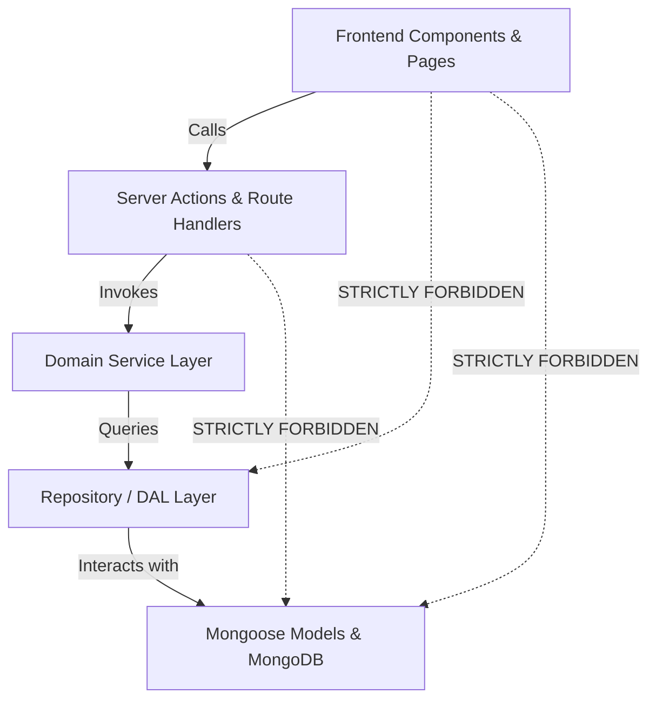

# Engineering & Code Standards Specification

> **Document ID:** DOC-TECH-004  
> **Status:** Approved Baseline (Phase 1, Part 1.3)  
> **Institution:** Axis Institute of Technology & Management  
> **Target Audience:** All Full-Stack Engineers & QA Engineers  
> **Last Updated:** November 2026  

---

## 1. TypeScript Strict Mode Configuration

All TypeScript code within Axis LinkUp must compile under strict type checking. The use of the `any` type is strictly prohibited in production code; where unknown data enters the system, `unknown` must be paired with Zod schema parsing.

### 1.1 Mandatory `tsconfig.json` Compiler Settings
```json
{
  "compilerOptions": {
    "target": "ES2022",
    "lib": ["dom", "dom.iterable", "esnext"],
    "allowJs": false,
    "skipLibCheck": true,
    "strict": true,
    "noImplicitAny": true,
    "strictNullChecks": true,
    "strictFunctionTypes": true,
    "strictBindCallApply": true,
    "strictPropertyInitialization": true,
    "noImplicitThis": true,
    "alwaysStrict": true,
    "noUnusedLocals": true,
    "noUnusedParameters": true,
    "noImplicitReturns": true,
    "noFallthroughCasesInSwitch": true,
    "noUncheckedIndexedAccess": true,
    "forceConsistentCasingInFileNames": true,
    "module": "esnext",
    "moduleResolution": "bundler",
    "resolveJsonModule": true,
    "isolatedModules": true,
    "jsx": "preserve",
    "incremental": true,
    "plugins": [{ "name": "next" }],
    "baseUrl": ".",
    "paths": {
      "@/*": ["./src/*"]
    }
  },
  "include": ["next-env.d.ts", "**/*.ts", "**/*.tsx", ".next/types/**/*.ts"],
  "exclude": ["node_modules"]
}
```

---

## 2. ESLint & Prettier Formatting Conventions

### 2.1 Prettier Configuration (`.prettierrc`)
Consistency in formatting eliminates diff noise and code review friction:
```json
{
  "semi": true,
  "trailingComma": "es5",
  "singleQuote": true,
  "printWidth": 100,
  "tabWidth": 2,
  "useTabs": false,
  "bracketSpacing": true,
  "plugins": ["prettier-plugin-tailwindcss"]
}
```

### 2.2 ESLint Rules
- Enforce `@typescript-eslint/no-explicit-any`: `error`.
- Enforce `@typescript-eslint/consistent-type-imports`: `error` (forces `import type { ... }`).
- Enforce `react-hooks/rules-of-hooks`: `error`.
- Enforce `react-hooks/exhaustive-deps`: `warn`.

---

## 3. Import Conventions & Architectural Boundaries

### 3.1 Path Aliases
All internal imports must use absolute path aliases mapped to `@/*`:
- `@/components/*`: UI primitives and composite feature components.
- `@/lib/*`: Utility functions, auth guards, Zod schemas, domain services.
- `@/lib/db/*`: Mongoose models, database connection client, and repositories.
- `@/types/*`: Shared domain types, interfaces, and DTOs.
- `@/hooks/*`: Custom client-side React hooks.

### 3.2 Architectural Boundary Enforcement
To maintain the **Modular Monolith** structure, cross-layer imports must obey strict rules:



- **Rule 1:** UI components (`components/*` and `app/*`) **must never** import Mongoose models or repository classes directly. All reads pass through Server Components or Server Actions.
- **Rule 2:** Server Actions and Route Handlers **must never** execute raw database queries directly; they must delegate to the Domain Service Layer.
- **Rule 3:** Domain Services **must never** import Next.js request/response objects (`NextRequest`, `NextResponse`, `cookies()`, `headers()`). Services must be pure, testable TypeScript classes.

---

## 4. Environment Variable Naming & Validation

### 4.1 Strict Naming Rules
- **Client-Accessible Variables:** Must be explicitly prefixed with `NEXT_PUBLIC_` (e.g., `NEXT_PUBLIC_CLERK_PUBLISHABLE_KEY`).
- **Server-Only Secrets:** Must **never** be prefixed with `NEXT_PUBLIC_` (e.g., `CLERK_SECRET_KEY`, `MONGODB_URI`).

### 4.2 Runtime Environment Validation (Fail-Fast Boot)
The application must validate all environment variables at startup using a Zod schema in `src/lib/env.ts`. If an essential secret is missing or malformed, the build/server crashes immediately with a descriptive error rather than failing silently during a student transaction:

```typescript
// src/lib/env.ts
import { z } from 'zod';

const envSchema = z.object({
  NODE_ENV: z.enum(['development', 'test', 'production']).default('development'),
  NEXT_PUBLIC_APP_URL: z.string().url(),
  MONGODB_URI: z.string().min(1, 'MongoDB connection string is required'),
  CLERK_SECRET_KEY: z.string().min(1, 'Clerk Secret Key is required'),
  NEXT_PUBLIC_CLERK_PUBLISHABLE_KEY: z.string().min(1),
  CLERK_WEBHOOK_SECRET: z.string().min(1),
  ABLY_API_KEY: z.string().min(1),
  CLOUDINARY_API_KEY: z.string().min(1),
  CLOUDINARY_API_SECRET: z.string().min(1),
  NEXT_PUBLIC_CLOUDINARY_CLOUD_NAME: z.string().min(1),
  RESEND_API_KEY: z.string().min(1),
});

export const env = envSchema.parse(process.env);
```

---

## 5. Standard API Response & Error Handling

### 5.1 Deterministic Response Envelope
All Server Actions and Route Handlers must return data adhering to the standard envelope:

```typescript
// src/types/api.ts
export type ApiResponse<T> =
  | {
      success: true;
      data: T;
      error: null;
      timestamp: string;
    }
  | {
      success: false;
      data: null;
      error: {
        code: string;
        message: string;
        details?: unknown;
      };
      timestamp: string;
    };
```

### 5.2 Error Handling Hierarchy
All business and system errors must inherit from the base `AppError` class:

| Custom Error Class | HTTP Status | Error Code | Common Trigger |
| :--- | :---: | :--- | :--- |
| `ValidationError` | `400` | `VALIDATION_ERROR` | Zod schema validation failure. |
| `UnauthorizedError` | `401` | `UNAUTHORIZED` | Missing or invalid Clerk session cookie. |
| `ForbiddenError` | `403` | `FORBIDDEN` | Insufficient role or unauthorized cross-department access. |
| `NotFoundError` | `404` | `NOT_FOUND` | Document (notice, request, assignment) does not exist. |
| `ConflictError` | `409` | `CONFLICT` | Duplicate roll number or conflicting timetable slot. |
| `BusinessRuleError` | `422` | `BUSINESS_RULE_VIOLATION` | Submitting an assignment past hard deadline. |

---

## 6. Structured Logging & PII Masking

### 6.1 Logging Standards
- All logs must be output as structured JSON strings in production, containing: `timestamp`, `level`, `module`, `action`, `userId` (if authenticated), and `message`.
- **Zero Sensitive Data in Logs:** Passwords, TOTP secrets, session tokens, and national identification numbers must **never** be logged.
- **PII Masking:** Student phone numbers and personal email addresses must be masked (e.g., `+91-XXXXX-98120`) if included in debugging logs.

### 6.2 Audit Logging vs. Application Logging
- **Application Logs (`console.error` / telemetry):** For operational debugging, exceptions, and latency tracking.
- **Audit Logs (MOD-19):** Persistent, immutable database records saved to `audit_logs` collection for security-sensitive operations (role modifications, notice deletions, request approvals, emergency broadcasts).

---

## 7. Testing Standards & Quality Gates

### 7.1 Unit & Integration Testing (Vitest)
- **Scope:** Domain services, validation schemas, and utility functions.
- **Coverage Goal:** `>= 80%` code coverage on core domain services (`NoticeService`, `RequestService`, `AssignmentService`).
- **File Naming:** `*.test.ts` placed adjacent to the tested unit or within `__tests__/`.

### 7.2 End-to-End Testing (Playwright)
- **Scope:** Critical user journeys spanning multiple roles:
  1. Student submits a Bonafide request &rarr; Admin approves &rarr; Student downloads certificate.
  2. Faculty creates assignment &rarr; Student submits file &rarr; Faculty grades and enters feedback.
  3. Super Admin triggers Emergency Mode &rarr; Student screen locks to alert modal within 3 seconds.
- **Execution:** Automated on every Pull Request before merging to `main`.

---

## 8. Dependency Management Hygiene

- **Lockfile Integrity:** `package-lock.json` must be committed to Git. Deployments use `npm ci` to guarantee deterministic builds.
- **Vulnerability Auditing:** `npm audit` is executed in the CI pipeline; builds fail if vulnerabilities of severity `High` or `Critical` are detected.
- **No Unused Packages:** Every added npm package must be justified in terms of bundle weight, maintenance status, and security track record.

