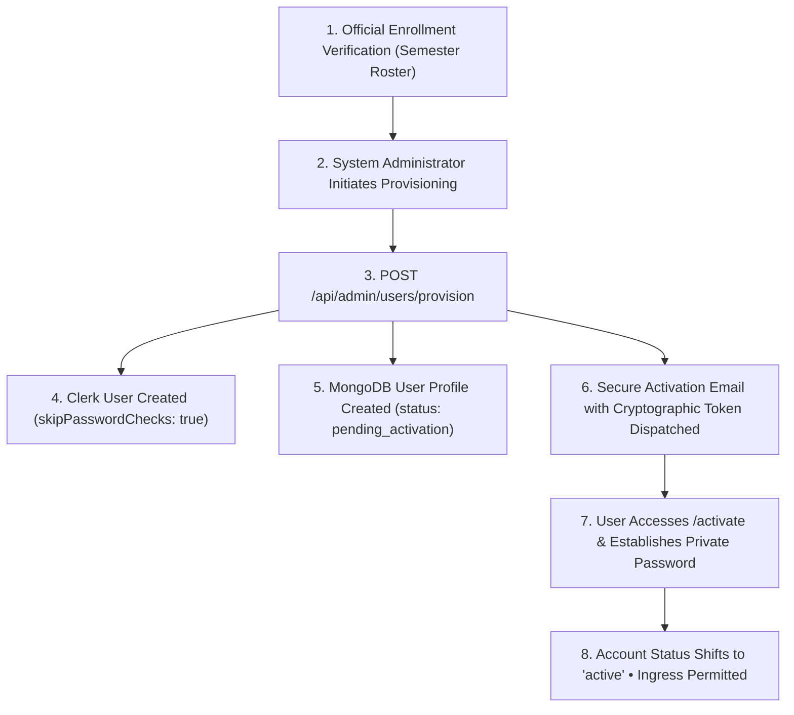

# AXIS LINKUP — PUBLIC REGISTRATION & CLOSED PROVISIONING POLICY
**Security Governance & Administrative Account Lifecycle Policy**  
*Document Version:* 2.0.0  
*Phase:* 4.8.4 — Landing Page & Login Experience Redesign  
*Institution:* Axis Institute of Technology & Management (AITM), Kanpur  
*Last Updated:* November 13, 2026  

---

## 1. Executive Policy Statement

In accordance with institutional data governance policies, cybersecurity mandates, and AICTE/UGC statutory guidelines, **Axis LinkUp permanently eliminates all public self-registration**.

Ordinary students, instructional faculty, and prospective users cannot create their own accounts via public web forms. All accounts originate exclusively from authorized administrative provisioning workflows executed by verified System Administrators.

---

## 2. Rationale & Threat Mitigations

| Threat | Pre-Phase 4.8.4 Vulnerability | Closed Provisioning Mitigation |
| :--- | :--- | :--- |
| **Fake Account Creation** | Unverified users could sign up with personal Gmail/Yahoo addresses. | Only accounts created by IT leadership exist in the identity store. |
| **Collegiate Impersonation** | Malicious actors could claim faculty or HOD identities. | Administrative provisioning strictly maps faculty records to official departments. |
| **Grievance Portal Spam** | Self-registered users could file spurious complaints. | Grievance submissions are restricted to verified enrolled students with valid roll numbers. |
| **Privilege Escalation** | Self-registered users could attempt to probe higher-level routes. | Zero-trust Edge and Server validation rejects any unverified account. |

---

## 3. Surface-Level Enforcement Inventory

### 3.1 Public Landing Page (`src/app/page.tsx`)
- The "Student Registration" button has been completely removed.
- All CTA buttons route strictly to the Three-Door Portal Ingress (`#portals` or `/sign-in`).
- Zero links to `/sign-up` exist across navigation, hero, or footer.

### 3.2 Closed Registration Route (`src/app/(auth)/sign-up/[[...sign-up]]/page.tsx`)
- The public `<SignUp />` form from Clerk has been completely removed.
- The route now renders a formal **Collegiate Closed Provisioning Gate** informing visitors:
  - Self-service account registration is disabled.
  - Students must contact their Department Registrar or HOD office to collect initial credentials.
  - Faculty must contact the Office of Academic Affairs.
  - Provides a one-click CTA to return to `/sign-in`.

### 3.3 Clerk Authentication Component Configuration
- In all `<SignIn />` instances, public registration options are hard-disabled:
  ```tsx
  signUpUrl={undefined}
  appearance={{
    elements: {
      footerAction: 'hidden',
      footer: 'hidden',
    }
  }}
  ```
- Users are never presented with a "Don't have an account? Sign up" link.

---

## 4. Administrative Account Lifecycle Workflow



---

## 5. Account Preservation Guarantee

> [!NOTE]
> **Zero Existing Account Disruption:**
> Retiring public registration does **NOT** modify or invalidate any existing student, faculty, or administrator accounts currently active in Clerk or MongoDB Atlas. All existing credentials, sessions, and role permissions remain 100% operational.
