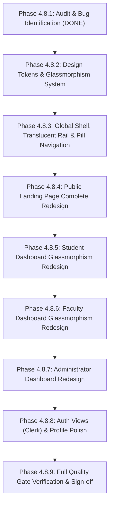

# AXIS LINKUP — REDESIGN PRIORITY PLAN
**Phase 4.8.1: UI Recovery & Phased Redesign Roadmap**  
*Document Version:* 1.0.0  
*Planning Date:* November 13, 2026  
*Target Visual Direction:* Light-Blue Frosted Glassmorphism (Inspired by [VerdantFlow](file:///C:/Users/prash/.gemini/antigravity/brain/92155752-4c25-454d-8c0f-1f2b79b1cb00/.user_uploaded/media_1794585990477_242653da.jpg))  
*Prerequisite:* User Approval of Phase 4.8.1 Audit Report  

---

## 1. Architectural Mandates & Non-Negotiable Boundaries

Before executing any redesign tasks, the following development boundaries must be strictly maintained:

1. **Zero Database / Schema Changes:** Under no circumstances should MongoDB models (`src/lib/db/models/user.model.ts`), Mongoose schemas, or repositories be modified.
2. **Zero RBAC / Permission Changes:** The approved DOC-AUTH-005 RBAC matrix and permission enforcement logic (`src/lib/auth/permissions.ts`, `src/lib/auth/rbac.ts`) must remain untouched.
3. **Preserve Clerk Authentication:** Real authentication flows, session handling, webhooks (`/api/webhooks/clerk`), and middleware route protection must remain intact.
4. **Preserve Truth-in-UI:** Do not invent mock data, fake student grades, or simulated statistics. All data presented must reflect authentic database records and honest phase statuses.
5. **Collegiate Adaptation:** Adapt the target visual language (light-blue glassmorphism, pill controls, translucent rails) to a premier college platform rather than copying unrelated corporate SaaS features.

---

## 2. Redesign Phase Sequence

---

## 3. Detailed Phase Breakdown

### Phase 4.8.2: Design Tokens & Glassmorphism Foundation
- **Goal:** Upgrade global CSS variables and design tokens in `src/app/globals.css` to establish the light-blue atmospheric background and modern frosted glass surfaces.
- **Key Deliverables:**
  1. *Luminous Atmospheric Gradient Background:*
     - Light Mode: `linear-gradient(135deg, #a0c4f8 0%, #b8d6fc 45%, #cfe2fe 100%)` with soft cyan-blue ambient radial glows.
     - Dark Mode: `linear-gradient(135deg, #091322 0%, #0f1f35 45%, #182e4e 100%)` with sapphire glass ambient glows.
  2. *Refined Frosted Glass Tokens:*
     - Lower opacity fill (`rgba(255, 255, 255, 0.52)` light / `rgba(15, 31, 53, 0.65)` dark).
     - Elevated blur: `backdrop-blur(20px)`.
     - Translucent white border: `rgba(255, 255, 255, 0.60)` light / `rgba(255, 255, 255, 0.12)` dark.
     - Colored ambient shadows: `shadow-2xl shadow-blue-900/10`.
  3. *Expanded Radius Scale:*
     - Introduce `--radius-pill: 9999px` for all capsule controls.
     - Set card radius default to `1.25rem` (`rounded-2xl`).
     - Set master canvas radius to `2.0rem` (`rounded-[32px]`).
- **Issues Resolved:** `BUG-007`, `BUG-008`, `BUG-014`.

---

### Phase 4.8.3: Global Application Shell & Pill Navigation
- **Goal:** Re-architect `AppShell`, `Sidebar`, `Topbar`, and `MobileDrawer` into the floating frosted-canvas architecture seen in the target benchmark.
- **Key Deliverables:**
  1. *Floating Master Canvas (`AppShell`):*
     - Wrap main viewport in a floating rounded glass container (`rounded-[32px] shadow-2xl`) on desktop (`md:` and above) set within the luminous gradient.
  2. *Translucent Sidebar Rail (`Sidebar`):*
     - Integrate sidebar as a translucent frosted rail inside the canvas container.
     - Active route items styled as bold pill buttons (`bg-blue-600 text-white rounded-xl shadow-md shadow-blue-500/30`).
     - Inactive items styled with clean slate typography and smooth hover transitions.
     - Add collegiate utility card at bottom: "Axis LinkUp Mobile App Sync" with QR code preview.
  3. *Capsule Topbar (`Topbar`):*
     - Transform search into a full pill capsule (`rounded-full bg-white/40 border border-white/60`).
     - Register interactive `Cmd+K` / `Ctrl+K` keyboard shortcut and command modal dialog.
     - Implement clean user profile capsule (round avatar + two-line name and role text).
     - Style breadcrumbs as subtle translucent pill chips.
- **Issues Resolved:** `BUG-004`, `BUG-005`, `BUG-006`, `BUG-010`.

---

### Phase 4.8.4: Public Landing Page Complete Redesign
- **Goal:** Replace the isolated, dark, developer-centric card with a complete, world-class collegiate portal homepage that effectively communicates AITM Kanpur's digital identity.
- **Key Deliverables:**
  1. *Institutional Header Navigation:*
     - Glassmorphic top bar with AITM crest, portal navigation links ("About AITM", "Academic Portals", "Campus Notices", "Admissions"), and Quick Sign-In action pill.
  2. *Hero Section:*
     - Expansive hero banner with engaging collegiate typography ("Empowering Academic Excellence & Campus Connectivity").
     - Clear dual CTA buttons: "Access Student Portal" (Primary Pill) and "Faculty / Staff Ingress" (Frosted Glass Pill).
     - Floating glassmorphic preview cards highlighting active campus stats (100% Digital Clearances, Fast Circular Dispatches).
  3. *Collegiate Portal Directory:*
     - Role-specific access cards for Students, Faculty, and Department Administrators detailing available services.
  4. *Public Bulletins & Announcements Feed:*
     - Public circular showcase previewing official university notices.
  5. *Institutional College Footer:*
     - Comprehensive footer with campus address (NH-2, Rooma, Kanpur, UP 208001), helpline contacts, accredited university affiliations, and copyright notices.
- **Issues Resolved:** `BUG-002`, `BUG-003`.

---

### Phase 4.8.5: Student Dashboard Glassmorphism Redesign
- **Goal:** Elevate `/student/dashboard` to match the spacious, modern SaaS layout of the target reference.
- **Key Deliverables:**
  1. *Spacious Welcome Banner:*
     - Modern greeting panel with personal avatar, semester enrollment chips, and quick dossier action pill.
  2. *Data-Rich Overview Metric Cards:*
     - 4 frosted-glass metric cards with large bold numbers, upward trend badges, and SVG sparkline/area wave silhouettes.
  3. *Academic Progress & Timeline Cards:*
     - Circular progress meter (inspired by the `53% SPRINT` circular gauge in the reference) displaying semester attendance / academic standing.
     - Clean timeline widget showing recent academic activities and notice dispatches.
  4. *Clean Quick Action Pills:*
     - Pill buttons for portal services with interactive informational modals for upcoming Phase 5 modules.
- **Issues Resolved:** `BUG-009`, `BUG-011`, `BUG-012`, `BUG-013`.

---

### Phase 4.8.6: Faculty Dashboard Glassmorphism Redesign
- **Goal:** Align `/faculty/dashboard` with the light-blue glassmorphic visual system.
- **Key Deliverables:**
  1. *Faculty Welcome & Academic Designation:*
     - Elevated header panel with employee credentials, department affiliation, and cabin hours formatted as clean chips.
  2. *Evaluation & Course Allocation Metrics:*
     - Frosted-glass metric cards with area wave silhouettes tracking assigned courses, evaluation dropboxes, and circular dispatches.
  3. *Class Roster & Evaluation Queue:*
     - Clean, minimal data table for enrolled student sections and grading rubrics.
  4. *Academic Schedule & Notice Desk:*
     - Weekly lecture calendar widget and department notice dispatch board.

---

### Phase 4.8.7: Administrator Dashboard Redesign
- **Goal:** Upgrade `/admin/dashboard` into an executive departmental management cockpit.
- **Key Deliverables:**
  1. *Departmental Population Metrics:*
     - Frosted cards displaying enrolled students, active faculty, administrative officers, and service requisitions with authentic counts from MongoDB.
  2. *User Directory & IAM Management:*
     - Modernized directory table with fluid pill filter chips ("All Users", "Students", "Faculty", "Admins"), capsule search input, and role boundary badges.
  3. *Service Requisition & Clearance Desk:*
     - Queue tracking for student bonafide, leave, and clearance requests.
  4. *Campus Poll & Broadcast Consoles:*
     - Visual poll cards and announcement dispatch interfaces.

---

### Phase 4.8.8: Authentication, Profile & Auxiliary Pages Polish
- **Goal:** Resolve theme collisions on authentication views and unify auxiliary surfaces.
- **Key Deliverables:**
  1. *Clerk Theme Unification (`/sign-in`, `/sign-up`):*
     - Remove all hardcoded dark classes and hex codes (`#0A2540`, `#F5A623`).
     - Bind Clerk appearance to platform design tokens, ensuring perfect contrast in both Light and Dark modes.
  2. *Profile Dossier (`/shared/profile`):*
     - Re-style profile cards with glassmorphic identity badges and session security details.
  3. *Access Error Pages (`/account-suspended`, `/pending-approval`, `/unauthorized`, `/not-found`):*
     - Upgrade error and ingress gate cards to the new floating glassmorphic style.
- **Issues Resolved:** `BUG-001`, `BUG-014`.

---

### Phase 4.8.9: Full Quality Gate Verification & Sign-Off
- **Goal:** Run complete end-to-end verification across the entire platform.
- **Mandatory Gates:**
  1. `npm run format:check` — 100% Prettier compliance.
  2. `npm run typecheck` — 0 TypeScript errors.
  3. `npm run lint` — 0 ESLint warnings/errors.
  4. `npm test` — 126/126 unit tests passing.
  5. `npm run build` — Clean production build across all routes.
  6. Multi-viewport manual verification across 320px to 1600px.

---

## 4. Work Breakdown & Priority Summary

| Sub-Phase | Focus Area | Bug Count Resolved | Severity Targets | Estimated Complexity |
| :--- | :--- | :---: | :--- | :--- |
| **Phase 4.8.2** | Tokens & Background System | 3 | P2, P3 | Medium |
| **Phase 4.8.3** | Global Shell & Navigation | 4 | P2, P3 | High |
| **Phase 4.8.4** | Landing Page Complete Redesign | 2 | P1 | High |
| **Phase 4.8.5** | Student Dashboard Redesign | 4 | P2, P3 | High |
| **Phase 4.8.6** | Faculty Dashboard Redesign | 2 | P2, P3 | Medium |
| **Phase 4.8.7** | Administrator Dashboard Redesign | 2 | P2, P3 | Medium |
| **Phase 4.8.8** | Auth Views (Clerk) & Profile | 2 | P1, P3 | Medium |
| **Phase 4.8.9** | Quality Gate & Verification | All | Quality Sign-off | Comprehensive |

