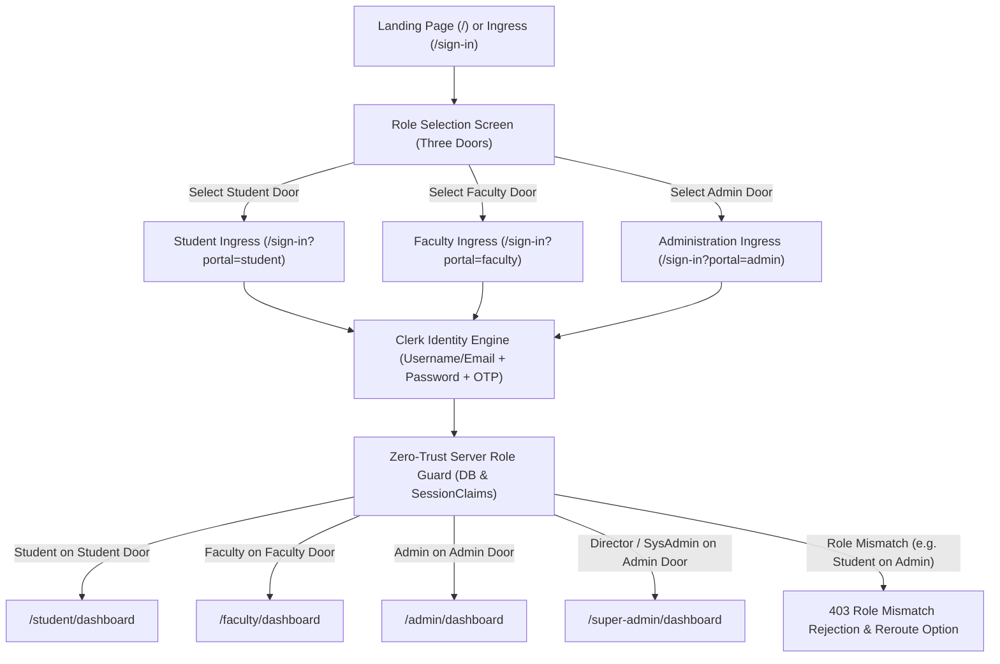

# AXIS LINKUP — THREE-DOOR ROLE SELECTION DESIGN
**Dedicated Ingress Architecture & Zero-Trust Portal Ingress**  
*Document Version:* 2.0.0  
*Phase:* 4.8.4 — Landing Page & Login Experience Redesign  
*Institution:* Axis Institute of Technology & Management (AITM), Kanpur  
*Last Updated:* November 13, 2026  

---

## 1. Concept & Architectural Rationale

Rather than forcing diverse collegiate personas through a generic, undifferentiated login box, **Axis LinkUp** implements a **Three-Door Ingress Architecture**:
1. **Student Portal Door**
2. **Faculty Workspace Door**
3. **Administration Console Door**

Each entry point establishes clear role expectations, displays persona-specific iconography, and routes into a customized authentication flow.



---

## 2. Portal Door Specifications

### 2.1 Student Portal Door
- **Identifier:** `portal=student`
- **Icon:** `GraduationCap` (`size-6`, royal blue accent)
- **Badge:** `Enrolled Scholars` (`variant="info"`)
- **Target Audience:** Undergraduate & Postgraduate Students
- **Description:** Access semester coursework, track real-time attendance, review lecture schedules, and submit formal grievances.
- **Authorized Downstream Destination:** `/student/dashboard`

### 2.2 Faculty Workspace Door
- **Identifier:** `portal=faculty`
- **Icon:** `BookOpenCheck` (`size-6`, indigo accent)
- **Badge:** `Instruction & Mentorship` (`variant="default"`)
- **Target Audience:** Professors, Lecturers & Lab Instructors
- **Description:** Manage assigned lecture batches, evaluate coursework submissions, dispatch notices, and moderate academic groups.
- **Authorized Downstream Destination:** `/faculty/dashboard`

### 2.3 Administration Console Door
- **Identifier:** `portal=admin`
- **Icon:** `ShieldCheck` (`size-6`, sky accent)
- **Badge:** `Governance & Directorate` (`variant="glass"`)
- **Target Audience:** Department HODs, Executive Director, and System Administrators
- **Description:** Executive gateway for Department HODs, Directorate leadership, and System Administrators managing IAM provisioning.
- **Authorized Downstream Destination:**
  - HOD / Department Admin: `/admin/dashboard`
  - Director / System Administrator: `/super-admin/dashboard`

---

## 3. Zero-Trust Authorization Boundary

> [!CRITICAL]
> **Portal Selection Is Intent, Never Authorization:**
> Selecting a portal door communicates user **intent**, but confers **zero permissions**. When the user signs in with their Clerk credentials, the server examines the user's authoritative role stored in MongoDB Atlas and verified session claims.

### Cross-Role Enforcement Rules:
1. **Student selects Admin Portal:** Authentication succeeds in Clerk, but ingress is blocked immediately with a security rejection banner:
   *"Access Denied: Your account is registered as a Student and does not have administrative privileges."*
   The UI offers a one-click button to redirect to the Student Portal.
2. **Faculty selects Student Portal:** Redirected safely to the authorized Faculty Workspace with an informational toast.
3. **Student selects Faculty Portal:** Blocked with a security rejection banner directing them to the Student Portal.
4. **Director or System Administrator selects Admin Portal:** Routed cleanly to the Directorate / Executive IT Console.

---

## 4. Component Interface & Usage

```tsx
import { RoleSelector } from '@/components/auth/role-selector';

// Embedded inside Landing Page
<RoleSelector />

// Standalone Full-Page Selector
<RoleSelector isStandalonePage onSelectPortal={(portal) => router.push(`/sign-in?portal=${portal}`)} />
```
