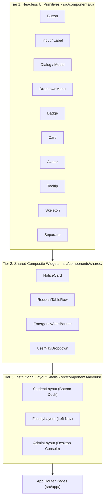

# Axis LinkUp — UI Architecture & Design System Foundation

> **Document ID:** DOC-UI-001  
> **Status:** Approved UI Foundation (Phase 2, Part 2.3)  
> **Institution:** Axis Institute of Technology & Management  
> **Framework:** Next.js 15+ App Router • React 19 • Tailwind CSS 4 • shadcn/ui (Radix UI)  
> **Last Updated:** November 2026  

---

## 1. Architectural Philosophy & Component Hierarchy

The user interface of **Axis LinkUp** is built upon a headless, composable, atomic component architecture. Rather than relying on rigid, monolithic component libraries that inflate bundle sizes, the platform adopts **shadcn/ui (Radix UI primitives)** coupled with **Tailwind CSS 4**.

Components are strictly partitioned across three architectural tiers:



1. **Tier 1 (Base UI Primitives):** Located in `src/components/ui/`. Un-opinionated, accessible, headless Radix primitives styled with design tokens via `class-variance-authority` (cva) and `cn`.
2. **Tier 2 (Domain-Agnostic Composites):** Located in `src/components/shared/`. Reusable compositions combining multiple Tier 1 primitives (e.g., status badges with icons, data tables, alert dialogs).
3. **Tier 3 (Role Layout Shells):** Located in `src/components/layouts/`. Structural frames providing sidebars, header rails, and breadcrumb navigation tailored to Student, Faculty, Admin, and Super Admin personas.

---

## 2. Directory Layout

```text
src/
├── app/
│   ├── globals.css                 # Master theme variables, OKLCH tokens, @theme inline
│   ├── layout.tsx                  # Root HTML shell, Geist fonts & global TooltipProvider
│   ├── page.tsx                    # Minimal placeholder home view
│   └── ui-preview/
│       └── page.tsx                # Isolated development preview catalog
├── components/
│   ├── ui/                         # Tier 1 UI Primitives (shadcn/ui / Radix)
│   │   ├── avatar.tsx              # User avatar with fallback initials
│   │   ├── badge.tsx               # Status & priority badges
│   │   ├── button.tsx              # Accessible button with cva variants
│   │   ├── card.tsx                # Structured card container
│   │   ├── dialog.tsx              # Accessible modal dialog (Radix Dialog)
│   │   ├── dropdown-menu.tsx       # Contextual action menus
│   │   ├── input.tsx               # Form text/number input
│   │   ├── label.tsx               # Form input label
│   │   ├── separator.tsx           # Semantic horizontal/vertical dividers
│   │   ├── skeleton.tsx            # Animated loading pulse
│   │   └── tooltip.tsx             # Hover explanation tooltips
│   ├── shared/                     # Tier 2 Composite widgets (Part 2.4+)
│   └── layouts/                    # Tier 3 Role layout shells (Part 2.4+)
└── lib/
    └── utils.ts                    # Class-name merging utility (cn)
```

---

## 3. Tailwind CSS 4 Integration Architecture

The application utilizes **Tailwind CSS v4** configured with `@tailwindcss/postcss`:

1. **CSS-First Theme Declaration:** Rather than relying on a heavy JS configuration object, design tokens and font mappings are declared directly in `src/app/globals.css` using the `@theme inline` block.
2. **OKLCH Color Space:** Color tokens leverage the modern `oklch()` color model for perceptually uniform lightness, preventing high-contrast color shifts across different displays and ensuring accessible text contrast.
3. **Class Merging Optimization:** Class name resolution is powered by `cn` (`@shadcn-ui/cn`), providing compiled, high-performance merging of conflicting Tailwind utility classes as a drop-in replacement for `clsx` and `tailwind-merge`.

---

## 4. Typography Scale & Font Strategy

Next.js Google Font optimization is configured in `src/app/layout.tsx`:
- **Sans-Serif Font:** `Geist Sans` (`--font-geist-sans`). Used for headings, body copy, and navigation labels.
- **Monospace Font:** `Geist Mono` (`--font-geist-mono`). Used for institutional IDs (e.g., student roll numbers, transaction IDs, code blocks).
- **Zero External Network Requests:** Fonts are automatically self-hosted and inlined by Next.js at build time, eliminating external Google CDN network latency.

| Typography Level | Tailwind Class | Semantic Element | Typical Usage |
| :--- | :--- | :---: | :--- |
| **Display / Title** | `text-3xl sm:text-4xl font-bold tracking-tight` | `<h1>` | Institutional landing hero, portal headers |
| **Heading 1** | `text-2xl font-semibold tracking-tight` | `<h1>` / `<h2>` | Page titles, module dashboard headers |
| **Heading 2** | `text-xl font-medium tracking-tight` | `<h2>` / `<h3>` | Section headers, card group titles |
| **Heading 3** | `text-lg font-medium` | `<h3>` / `<h4>` | Modal titles, sub-section headers |
| **Body Regular** | `text-sm text-foreground leading-relaxed` | `<p>` / `<span>` | Primary paragraph text, form descriptions |
| **Muted Text** | `text-xs text-muted-foreground` | `<p>` / `<span>` | Metadata, timestamps, helper descriptions |
| **Micro Caption** | `text-[10px] uppercase tracking-wider font-mono` | `<span>` | Badge category tags, table column headers |

---

## 5. Accessibility (a11y) & WCAG 2.1 AA Compliance

All components conform to **WCAG 2.1 Level AA** standards:
1. **Visible Keyboard Focus States:** Every interactive element defines explicit focus indicators via `focus-visible:border-ring focus-visible:ring-3 focus-visible:ring-ring/50`.
2. **Keyboard Navigation:** Modals (`Dialog`) and menus (`DropdownMenu`) trap focus when active, handle `Escape` key dismissal natively, and restore focus to trigger elements on close.
3. **Semantic HTML & ARIA:** Form inputs are bound to `<Label>` via explicit `htmlFor` attributes; buttons reflect `aria-expanded` and `aria-invalid` states.
4. **Motion Sensitivity:** CSS animations respect the user's system preferences via `@custom-variant dark` and standard Tailwind motion-reduction tokens.

---

## 6. UI Preview Tooling & Removal Instructions

To verify component rendering without modifying application production code, an isolated preview page is established at:
- **Route:** `http://localhost:3000/ui-preview`
- **File:** `src/app/ui-preview/page.tsx`

### Developer Maintenance:
- **Retention:** The preview route can be safely retained during Phase 2 development as an interactive component playground.
- **Decommissioning:** To remove the preview before production release, simply delete the folder `src/app/ui-preview/` and remove the preview link from `src/app/page.tsx`. Zero business logic or dependencies are affected.

