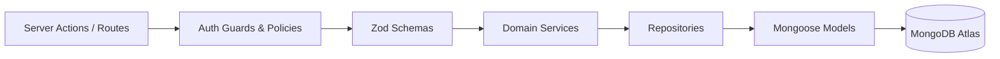

# Core Backend & Foundation Infrastructure (`src/lib/`)

This directory contains cross-cutting foundation services, the data access layer (DAL), authentication policies, validation schemas, and external cloud integrations for **Axis LinkUp**.

## 1. Directory Structure & Responsibilities

```text
src/lib/
├── auth/               # Session extraction, role guards (requireAuth), RBAC engine
│   └── policies/       # Fine-grained Attribute-Based Access Control (ABAC) policies
├── db/                 # Data Access Layer (DAL)
│   ├── models/         # Mongoose schemas and model definitions (25 collections)
│   └── repositories/   # Domain repository queries enforcing the ESR indexing rule
├── integrations/       # Managed cloud service SDK clients (Clerk, Ably, Cloudinary, Resend)
├── services/           # Reusable domain business logic orchestration
├── validations/        # Global runtime Zod validation schemas (forms, mutations, env)
└── utils/              # Pure utility functions (formatting, sanitization, class merging)
```

## 2. Layered Service-Repository Pattern

Backend data mutations and queries must follow a strict unidirectional flow:



## 3. Boundary Rules

1. **Server-Side Isolation:** Modules in `src/lib/db/`, `src/lib/auth/`, and `src/lib/integrations/` run exclusively on the server and must never be imported into client-side React components (`'use client'`).
2. **Repository Encapsulation:** Repositories encapsulate all Mongoose operations (`find`, `aggregate`, `updateOne`), returning lean plain JavaScript objects (DTOs) rather than hydrated Mongoose documents with internal prototypes.
3. **Zero Secrets in Client:** Any integration secret (Clerk Secret Key, Ably API Key, Cloudinary Secret, Resend Key) must reside strictly within `src/lib/integrations/` and server-only modules.
